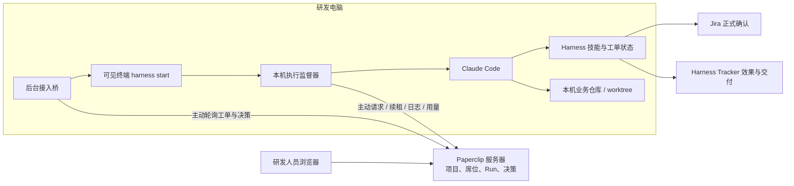

# 个人电脑快捷接入与主动连接实现

日期：2026-10-07

## 交付目标

把管理员手动登记 Agent、SSH 环境、电脑路径和项目 UUID 的过程，收敛为“登录网站 → 复制命令 → 确认本机配置 → 选择项目仓库”。现有 SSH 席位保持原执行路径。

## 推荐：接入我的电脑

**场景**：组织研发人员希望连接自己的电脑，沿用本机 Claude 和 Harness 配置，不配置 SSH、不输入智能体或项目 UUID。

1. 使用本人网站账号登录，进入 **席位 → 接入我的电脑**。
2. 填写席位名称，点击 **生成接入命令**，复制到这台电脑的终端执行。命令中的一次性接入码有效期 15 分钟，请勿转发。
3. 安装器检测本机 Claude、Harness 工程和 Jira 配置。检查目录后输入 `yes`。多个候选目录会让你选择；没有配置时会提示准备，安装器不会代替你安装 Claude 或克隆业务仓库。
4. 从列表选择组织项目及本机 Git 仓库。安装器核对 origin 和基线分支，不需要输入 UUID。回车可以暂时跳过，之后执行 `harness repo connect`。
5. 返回席位页面确认电脑在线。默认保持人工启动策略。后续在 Project 的“接入工单”登记 Jira 子工单，然后在本机运行 `harness start ATSES-XXXXX --confirm-no-other-executor`；macOS 也可以通过网页请求启动，由本机 Terminal 确认。

### 准备与权限

- macOS / Linux，Python 3.9+、Git、可运行的 Claude Code、当前版本 Harness 工程，以及本机可访问网站的网络。Linux 后台服务使用当前用户 systemd；没有用户 systemd 时使用 `--no-service` 并手动启动安装器输出的 watcher 命令。Windows 原生安装尚未提供，可在 WSL 使用 Linux 路径。
- 账号需要 `agents:create` 权限。组织要求新智能体审批时，快捷接入会停止，并要求管理员按原审批流程处理；它不会自动批准智能体。
- 模型密钥和 Jira 凭证保留在电脑上。网站只登记配置来源、摘要及路径等信息。本机 Agent 使用其已经配置好的模型服务，包括第三方中转站。
- 一台电脑在同一组织只保留一个席位。已经安装的电脑复用原席位，不会自动把旧 SSH 席位改成主动连接。
- 项目共有仓库 URL 和基线分支；每台电脑分别选择自己的源码目录。Harness 根目录不是业务源码映射。

### 运行在哪里

| 位置 | 运行内容 |
| --- | --- |
| Paperclip 服务器 | 账号、项目、工单、真实 Run、决策、日志和用量管理 |
| 研发电脑 | 后台接入桥、执行监督器、可见终端、Claude、Harness、业务源码 |
| 通信 | 本机主动向网站请求任务、续租、回传日志与用量，不需要服务器 SSH 登录电脑 |

本机主动启动会创建真实 Paperclip Run。只有匹配本机一次性启动意图的运行才能领取；网页评论不会启动第二个 Claude。公共技能按该智能体已分配的技能打包到本机临时目录，并与 Harness 技能一起加载；当前包限制 2 MiB / 1000 个文件，跳过符号链接。运行凭证仅用于该 Run，运行结束清理临时 MCP 凭证文件。

### 断线、取消和重新接入

本机监督器定期检查租约。网站取消运行或连接长期失败时停止对应 Claude；网络请求超时会延长实际停止时间。服务器重启后不会恢复派发旧执行包，本机收到旧租约失效后停止。**网页运行结束不等于电脑进程已确认停止**，重新启动前仍需核对本机状态。不要因为等待而在另一台电脑同时执行同一工单。

安装过程中已写入本机配置但尚未完成登记时，可以重跑安装命令，复用配置并完成后续登记。已有配置不完整或后台服务指向其他版本时，请按提示核对。不要删除凭证后重复创建新席位。

## 高级接入与日常管理

## 实现入口

- `ui/src/components/QuickSeatConnect.tsx`：本人账号创建短期接入码，显示安装命令。
- `server/src/routes/dsp7-quick-seats.ts`：签发/消费接入码，创建独立 Agent 和席位密钥，领取运行及回传执行结果。
- `server/src/services/dsp7-outbound.ts`：与原生 claude_local adapter 对接，仅为合法本机启动唤醒创建待领取执行包。
- 接入桥 `quick_install.py`：检测本机配置、校验安装包摘要、登记运行配置及项目仓库。
- 接入桥 `outbound.py`：本机领取真实 Run，在本地选择已登记的 Claude 执行程序，监督租约并回传日志和用量。
- `interactive.py`：沿用启动意图、可见 PTY、单执行器保护、Jira 确认和同会话 Stop hook 续传；新增父监督进程退出保护。

## 运行时架构

## 权限与失败处理

接入码随机生成，服务器仅保存摘要，有效期 15 分钟，一次性消费；消费时再次核对当前组织访问权限及 agents:create 权限。组织审批策略变化、重复机器指纹、旧接入码重复消费均拒绝。运行领取只允许对应席位独立密钥，并核对机器身份、配置版本和真实活动 Run。

运行包只保存在当前服务进程内，领取后不重复派发；服务重启使旧租约失效。没有网络自动重试执行模型的逻辑。回执按序号串行处理，重复回执不重复记账。模型用量未知时运行失败，不填零。取消或断线后的停止状态仍须本机核对，保留现有确认与单执行器保护。

## 发布与验证边界

本次进行 TypeScript 类型检查、Python 语法检查和 UI/后端构建；部署记录在本文件后续章节补充。新的电脑实际消费接入码、可见终端执行、审批续传和结束用量的完整场景，需要新电脑验收，构建成功不能替代该验收。旧 Mac SSH 席位不迁移，不借用原机器指纹创建重复席位。

## 发布记录

- 已发布到 `http://10.60.43.53:3100`；发布前无 running / queued 运行，原席位配置未修改。
- 备份：`/home/fg/paperclip/private/quick-seat-backup-20261007-044625`。更新 5 个后端运行模块、前端及公开安装器；旧前端哈希资产保留。
- 前后端 TypeScript、后端编译、UI 构建、Python 语法检查、diff 空白检查通过。
- 发布后健康接口恢复 200；安装器、安装包、manifest、在线帮助可下载，安装包与 manifest 摘要一致。
- 当前公开包 SHA256：`35358d9a7b999da1e65b2ad7d80152987f7d2afe477bfb0986e110d81f05b4de`。
- 没有创建重复 Mac 席位、迁移现有 SSH 席位、触发 Jira 回放或发送钉钉消息。新电脑端到端接入与执行尚未验收。

Harness 命令入口已补充 Linux 主动连接转发；安装器在创建席位前检测终端入口能力，版本不满足时提示更新 Harness。Linux 使用该修改后的 Harness 版本，原 SSH Mac 路径保持有效。

快捷安装器旧席位兼容修复：`.harness-local.json` 为可选；优先使用明确登记的接入桥目录，否则查找 Harness 兄弟目录 `paperclip-dsp7-integration`，找不到时允许选择原接入桥目录。复用前核对网站地址和 Harness 目录；错误输出保留可操作的文件/权限/网络原因，不回显配置或 HTTP 响应体。
