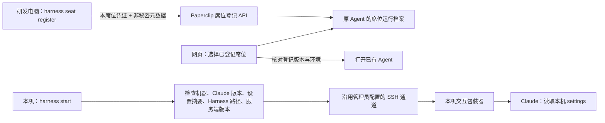

# 第一期：本机席位登记与网页关联

日期：2026-10-07

## 已实现的流程

Paperclip 服务端在 10.60.43.53:3100；Claude、Harness、桥及源码保留在研发电脑。网页从已登记席位选择运行电脑并复用该席位 Agent，避免为同一执行电脑重复创建执行者。初始 Agent、SSH 环境、机器身份、授权用户及 Agent 凭证仍由管理员配置。



## 本机操作

先完成原有席位初始化及独立凭证安装。当前电脑登记示例：

```sh
cd /Users/leo/work/fingard/base-harness-infrastructure-dsp7
harness seat register --claude /usr/local/bin/claude --settings /Users/leo/work/fingard/base-harness-infrastructure-dsp7/.claude/settings.local.json
harness seat info
harness seat check
```

- `seat register`：检查可执行文件、读取 `--version`、验证 JSON 配置及 Harness 根目录，提交路径、版本、配置摘要、环境关联。默认从已登记配置或 Harness 的 settings.local.json 取配置。用 `--use-default-settings` 显式改用 Claude 默认配置。
- `--environment UUID`：必须等于管理员为原 Agent 设置的环境，不允许凭本机凭证重定向 SSH。
- `seat check`：对比本机和服务端登记；一致时刷新检查时间。配置或 Claude 版本变化时应先核对，再运行 `seat register` 更新。
- `seat info`：显示已登记配置，不展示 API 密钥。
- 第一次登记或配置变更遇到排队／运行中的任务会拒绝更新；结束任务后刷新。未改变配置的检查可以刷新时间。

## 网页操作

新建 Claude 的“连接模型”步骤增加“关联已登记的本机席位”。选择席位后展示环境、Claude 路径和版本、设置路径、Harness 根目录、登记版本与最近检查时间。点击“使用此席位，打开已有智能体”，服务端重新核对版本、授权、环境状态、执行配置及 24 小时检查有效期，然后打开原 Agent。

这条入口不调用 hire，不新增 Agent，不保存新的密钥，不修改原 Agent 的领域指令或技能配置。Project 的 Jira 接入申请也会核对所选席位登记。无登记或过期时回本机执行 register/check，并刷新网页。

## 配置实际生效与保护

交互包装器读取本机登记并使用该 Claude 路径，将 settings 文件通过 `--settings` 传给 Claude。会话 Stop hook 合并原 settings 保持原审批续传机制。本机启动以及包装器执行前再次检查文件摘要、版本、机器身份、环境和登记版本。缺失、变更或不匹配时停止，不使用另一电脑的配置。设置文件内容及密钥不上传。

注册 API 仅接受预授权席位自己的 Agent 凭证，只更新运行档案及审计记录；无法创建 Agent、改变通道或修改凭证。网页查询限定组织和席位授权人；管理员可以查看本组织席位。服务端记录执行参数和环境配置的摘要，变化后旧登记无效。

保留 Jira 正式确认、Project 仓库绑定、独占登记、单执行者和当前每台桥一张启用工单的门禁。

## 边界

登记有效不证明电脑当前在线或 API 密钥可用。第一期不新增持续心跳、自动发现电脑、网页远程配置密钥或自动安装 SSH 通道；实际执行沿用已有 SSH。`seat register/check` 仅调用 Claude `--version` 和元数据 API，不调用模型，不运行真实工单。

默认配置模式依赖 Claude 自身配置优先级，不能对用户全局配置和所有进程环境生成完整快照；需要锁定 Harness 设置时使用显式 `--settings`。

## 交付检查

UI、服务端 TypeScript 编译与 UI 生产构建；Python 语法检查；部署后健康与登记 API 读回。未执行测试套件、浏览器交互验证或真实 Jira／模型任务。

## 本次部署结果

- 当前 Leo Mac 登记版本 1，Claude `2.1.206 (Claude Code)`，环境 `Leo Mac Claude`，Agent `f38bb5a9-031c-4a4f-b58d-09272e47a966`。
- 配置文件 `/Users/leo/work/fingard/base-harness-infrastructure-dsp7/.claude/settings.local.json`；原 Agent 未新增网站认证变量或官方连接，现有环境变量仅 HOME、PATH、CLAUDE_CONFIG_DIR。
- `harness seat register`、`harness seat check` 成功；服务端席位清单返回 usable=true，网页关联所用 verify API 返回原 Agent 和 revision=1。
- UI 类型检查、服务端 TypeScript 编译、UI 生产构建、Python 语法检查和 diff 空白检查通过。
- Paperclip 健康、首页、新主脚本、在线帮助、帮助站内路由均 HTTP 200；线上帮助包含登记说明；Tracker 首页 HTTP 200。
- 服务端/UI 备份 `/home/fg/paperclip/private/seat-phase1-before-20261007-030832`；本机配置另有 0600 备份。只替换 dsp7-seats.js 和网页资源，重启 Paperclip，未修改其他服务。
- 未做浏览器点击、真实工单、模型调用或测试套件验证。

- 本机接入桥 LaunchAgent 已重载以加载新代码；重载前启用工单数为 0。
