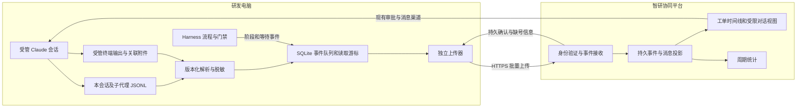

# 受管 Claude 会话采集、Harness 阶段与席位统计设计（评审修订版）

- 日期：2026-10-21
- 状态：设计方案；尚未实施、发布或完成验收
- 采集策略：默认“完整可见记录”，在受管任务边界内最大范围上报；替代此前默认工具摘要的策略
- 适用：智研协同平台、Paperclip DSP7 接入桥、base-harness-infrastructure-dsp7、Harness Tracker
- 本版取代会话中此前提出的采集方案；功能不能仅凭本文件视为已经具备。

## 1. 目标与范围

研发在本机 Claude 终端执行任务，负责人和管理员在网页查看本次受管会话可采集的用户可见记录、领域阶段、运行和等待状态，后续据此形成工单与时间统计。

本版明确：

1. 第一阶段只采集新启动、明确绑定工单的受管会话。独立运行 `claude`、接入前历史会话和手工关联已有会话不在第一阶段范围内。
2. 默认启用“完整可见记录”：最大范围上报本次受管会话中用户可见的输入、回复、工具调用与完整结果、子代理记录、上下文压缩摘要、会话控制事件及可归属的终端补充输出。网页折叠或摘要展示不缩减底层保存正文。
3. 对话以 Claude 持久化记录为主，受管终端与 Harness 事件作补充；不承诺模型内部隐藏推理、运行时未提供的内容或电脑上全部会话可见。敏感信息脱敏、显式排除和来源本身截断必须标识。
4. 领域阶段由 Harness 流程和门禁提供，不能用对话猜测阶段完成。
5. 会话存在、任务未结束、Agent 正在执行是不同事实。无输出不能直接判定空闲。
6. 数据缺失或身份不确定时显示“未知／缺口”，不能补造对话、耗时、Token 或完成百分比。
7. 采集不改变工单独占、预算、审批、执行暂停和本机单执行器规则；同步重试不重跑模型和工具。

## 2. 当前基础与新增能力

以下为当前源码核对结果，不代表此次线上运行验证：

| 位置 | 当前能力 | 本设计新增 |
| --- | --- | --- |
| `integrations/dsp7-bridge/interactive.py` | 终端输出写本机 `terminal.log`；结束时 `usage_ledger` 读取精确会话及子代理 JSONL，提取用量和结束摘要 | 版本化增量解析、受管会话绑定、消息投影、采集状态 |
| `integrations/dsp7-bridge/outbound.py` | 上报包装器输出、运行回执与用量 | 独立的持久化采集队列和上传器 |
| `server/src/services/dsp7-outbound.ts` | 当前运行在内存中的租约、回执序号与日志传递 | 可跨服务重启、允许结束后补传的独立采集接口；不复用临时运行租约 |
| 席位心跳／Harness 确认 | 在线、执行、等待决策与提醒 | 状态证据、时间区间、阶段事件 |
| 席位负责人管理 | 管理员分配负责人，负责人配置席位 | 会话历史访问、采集权限和转交边界 |

相关已存在设计：[负责人管理](2026-10-15-seat-owner-management.md)、[Windows 接入](2026-10-15-native-windows-seat-access.md)。

## 3. 运行架构与责任



- 接入桥：采集和传输，不裁决领域阶段是否完成，不因重传恢复任务。
- Harness：阶段、门禁证据、明确执行段和人工等待边界；复用已有计时规范，不另建冲突口径。
- 平台：公司和会话授权、持久接收、受限展示、审计和统计。
- Tracker：保留领域交付、效果与质量数据；以稳定工单身份关联，不把平台运行失败直接当业务 Bug。
- 默认上传完整可见内容的脱敏结构化记录、受管终端补充输出和会话关联附件；不上传未经筛选的原始 JSONL、整机终端历史或无关文件。终端补充记录与结构化对话分开保存，避免重复计费和重复显示。

## 4. 身份关系：会话不等于执行轮次

```text
companyId → taskId → runId（运行轮次）
                    ↕ sessionRunBinding（带事件边界的关联）
              managedSessionId → 主／子 Claude 会话 → collectorStream
```

### 4.1 标识

| 字段 | 含义 |
| --- | --- |
| `managedSessionId` | 平台分配的稳定受管会话 ID，不直接假设等于 runId |
| `nativeSessionId` | Claude 原生会话标识；与设备、配置目录共同确定来源 |
| `runId` | 一次平台执行轮次；同一会话可恢复到后续轮次 |
| `parentManagedSessionId` | 子代理归属，不能仅按时间邻近推断 |
| `seatId / machineId / enrollmentEpoch` | 席位、设备及登记代次，阻止其他设备重放 |
| `ownerUserIdAtStart` | 本轮执行时负责人快照；后续负责人变更不改历史归属 |
| `bindingEpoch / startCursor / endCursor` | 轮次绑定及范围，避免恢复后历史消息重复计入新轮次 |

### 4.2 绑定约束

- 启动前平台验证工单、席位、运行独占和设备身份，持久登记受管会话，再允许采集。
- 接入桥只定位当前已验证 nativeSessionId 对应文件，不遍历读取无关会话正文。目录变化监听只用于发现授权来源。
- 子代理必须有可验证的父会话关联；未知父子关系作为采集告警，不猜测归属。
- 同一会话不能同时绑定不同工单；第一期禁止把已有其他工单上下文直接转交新工单。
- 恢复同一会话时，消息属于一次稳定会话投影，通过事件范围关联运行；跨轮次重复行不重复显示和计费。
- 结束后继续写入的事件，只在已授权范围内补传，不能自动扩展为新的执行授权。

## 5. 采集事件与网页消息分层

### 5.1 来源读取

- 文件变化通知加定时轮询；读取二进制字节偏移，正确处理 UTF-8 跨块字符。
- 仅读取完整 JSON 行，未完成行保留；读取游标与本地事件入队在同一 SQLite 事务提交。
- 保存源文件身份、代次、读取偏移和解析器版本；Windows 不只依赖 Unix inode，结合文件身份、大小及已读边界摘要判断替换／截断。
- 轮转、截断和重复扫描从新代次恢复；可重建去重，不静默跳过未识别区间。
- 支持的 Claude 版本与 JSONL 结构建立兼容清单。未知结构生成带位置和错误码的缺口事件；诊断信息不得携带未脱敏原文。

### 5.2 标准事件

最小信封：`protocolVersion, eventId, streamId, sequence, eventType, managedSessionId, bindingEpoch, sourceGeneration, sourceOffset, parserVersion, occurredAt, observedAt, payload`。

- `eventId` 对同一来源记录重扫保持稳定；`sequence` 为本地持久生成的流内连续序号，不采用时间戳作唯一 ID。
- 服务端从绑定推导 company/task/run/seat 等可信身份，客户端传入的关联只能作为校验信息。
- 消息类：用户完整输入、助手完整可见回复、工具调用与完整参数／结果、消息修订、上下文压缩摘要及边界。
- 补充类：受管终端输出、会话控制／权限提示、附件清单、分块内容、引用关系、来源截断和脱敏说明。
- 生命周期类：会话开始、恢复、响应结束、会话退出、异常、子代理建立。
- 采集类：来源发现、解析异常、缺口、暂停、恢复、补采扫描完成。
- 领域类：阶段开始／门禁通过／失败／重开／跳过，以及执行段和人工等待。
- 用量类：独立观察值，不把每条文本更新再次作为 Token 增量。

### 5.3 默认完整可见记录的采集矩阵

以下属于一期默认交付；“完整”均指来源实际可获取、经脱敏且未被显式排除的内容。

| 来源／内容 | 默认采集与保存 | 边界与呈现 |
| --- | --- | --- |
| 用户输入 | 本机和网页输入的完整正文、可获取的附件引用 | 按原生消息／投递回执关联，保留来源，不重复生成消息 |
| Claude 回复 | 全部可见文本及修订；流式中间版本仅在来源提供时采集 | 不只保存最终摘要；不伪造未落盘的流式片段 |
| 工具调用 | 工具名、调用 ID、完整参数、开始／结束和错误 | 对密钥字段脱敏；工具运行状态不依赖正文推断 |
| 工具结果 | 来源提供的完整 stdout／stderr、文本、代码、差异和结构化结果 | 网页默认折叠；来源本身已截断时标注，不能称作完整工具原始输出 |
| 子 Agent | 所有可验证归属的子会话输入、回复、工具与生命周期 | 保留父子关系；扫描范围仅限已绑定主会话的后代 |
| 压缩与会话控制 | 可获取的压缩摘要、压缩边界、恢复、错误、权限与决策提示 | 预先采集的旧正文不因上下文压缩删除；未捕获历史无法从摘要还原 |
| 受管终端补充输出 | 桥接进程实际观察到的本会话终端输出、CLI 提示和工具补充输出 | 脱敏、去 ANSI／控制符，以独立终端视图呈现；不能用终端转录冒充精确消息 |
| 图片、文件等会话附件 | 会话已引用或工具明确产出的附件，其内容在范围验证与脱敏后上传 | 保留 MIME、名称、大小、摘要、来源和引用；无法安全处理的内容只报元数据及缺失原因 |

- 可采集的运行元数据、模型／用量、时间、退出码和阶段证据一并保留；正文不进入用量累计入口。
- 不自动遍历上传整个仓库、所有读取过的文件、MCP 数据源或电脑目录。工具实际返回的内容属于会话；未返回的文件仅在明确作为会话附件时处理。
- 附件只读取经验证的受管会话引用和允许目录；解析规范路径并检查符号链接，禁止任意路径、URL 抓取或跨任务附件引用。保存采集时的内容版本，不能用稍后变化的文件冒充当时内容。
- 未识别记录类型报告格式与位置缺口；只保留适配器能安全识别并脱敏的可见字段，不为追求范围直接上传未知原始记录。
- 隐藏推理、系统／开发者隐藏提示及其内部状态不因出现在本机文件中就自动上传；运行时明确展示给用户的技能加载／配置提示可按可见内容记录。

### 5.4 消息投影

- 按会话、原生消息 ID、内容块 ID 和修订版本更新消息；同一助手消息多次写入不会产生多条重复回复。
- 工具调用按调用 ID 关联结果；子代理嵌套展示，不混入主助手角色。
- 无稳定来源 ID 时使用解析器明确的来源标识策略；无法确定是否同一消息时标注歧义，不能用“文本相同”直接删除合法重复消息。
- Token 独立按来源消息去重、修订；JSONL 观察值、CLI 结果和现有用量上报选定一个权威累计入口，其他只对账，不叠加。
- 追加式采集事件保存完整的脱敏可见内容及分块／附件引用，投影可重建；网页摘要是展示投影，不替代正文。原始 JSONL 仍由 Claude 在本机维护。

## 6. 本地队列与服务端确认协议

### 6.1 独立传输

不复用当前 `dsp7-outbound-runs` 的活跃运行内存租约。新增持久会话采集授权与接口，建议形态（尚未实现）：

| 接口 | 用途 |
| --- | --- |
| `POST /api/agents/:seatId/managed-sessions` | 为已验证运行申请／恢复绑定 |
| `POST /api/agents/:seatId/managed-sessions/:sessionId/events` | 按 stream 批量上传事件 |
| `GET /api/agents/:seatId/managed-sessions/:sessionId/receipts` | 读取连续确认位置和缺号区间 |
| `POST /api/agents/:seatId/managed-sessions/:sessionId/attachments` | 申请绑定会话的可续传附件上传，校验大小、类型与摘要 |
| `GET /api/companies/:companyId/managed-sessions/:sessionId/attachments/:attachmentId` | 独立授权读取附件，不暴露公共存储地址 |
| `POST /api/agents/:seatId/managed-sessions/:sessionId/finalize` | 声明各流结束游标、采集边界和已知缺口 |
| `GET /api/companies/:companyId/issues/:taskId/managed-sessions` | 返回有权查看的会话元数据 |
| `GET /api/companies/:companyId/managed-sessions/:sessionId/messages` | 受限对话分页，独立授权 |

### 6.2 接收规则

- 每个主／子会话采集流独立递增序号；流创建时记录来源身份与初始序号。
- 上传至少一次；以组织、受管会话、流、序号和 eventId 唯一约束幂等接收。相同身份不同内容返回冲突，不静默覆盖。
- 一个批次原子校验和落库，成功提交后返回 `ackSequence`（已连续确认的最大序号）以及缺号区间。
- 第一版同一流保持顺序上传；出现缺号要求重传，不能用后续序号跳过缺口。
- 服务端重启后确认位置仍存在；本地仅清理已确认数据。读取游标与上传确认游标分开保存。
- 重试采用退避和抖动；初始批量目标为每秒、最多 100 条或 256 KiB。32 KiB 为单个传输内容块的上限，不是逻辑消息长度上限；长消息和工具结果自动分块，不能因展示限长截断已采集正文。
- 内容块携带 contentId、revision、partIndex、结束清单和脱敏后完整内容摘要；服务端确认所有块及清单后才标记正文可完整读取。UTF-8 边界正确拆分，失败只重传缺块。
- 大型文本和二进制附件走绑定会话的可续传存储，正文保留引用；附件完成后校验大小与内容摘要。默认单附件上限 100 MiB、每会话附件总量 1 GiB，组织可调整；超限保留元数据、原因和可操作提示，不冒充已上传。附件积压使用独立磁盘配额，默认 2 GiB，并纳入统一容量告警。
- 断网正常补传，首次持久化展示目标在网络正常时为 5 秒内；SSE 可用于提示刷新，但断线后仍以持久分页游标恢复，不能依赖 SSE 作为唯一记录。
- 序号完整只证明客户端已提交事件连续，不证明来源文件无遗漏。

### 6.3 执行结束、断网及容量

- 执行授权结束后，保留绑定本设备、会话和来源代次的只追加补传权限，默认 7 天；不允许由补传请求发起 Claude、工具或审批。
- 补传令牌短期有效且可撤销；续期必须仍属于该登记代次和明确绑定。不得依赖已失效的当前轮次运行令牌。
- 活动会话每小时和退出时做来源重扫对账，进程异常后恢复补采；缺失文件或解析不支持显示缺口。
- 本地正文队列默认上限 1 GiB：80% 提醒，达到上限暂停正文入队，保留缺口／状态所需的预留空间；不得静默丢弃最旧未确认事件。容量恢复后从最后已入队位置补采仍存在的来源，区别于用户主动暂停采集的不补采策略；来源已删除或附件未快照时记录不可恢复缺口。
- 采集故障默认不终止领域任务；页面持续告警。任何组织级“采集失败即禁止新开工”策略需单独配置，不能用采集重试重放任务。

## 7. 同步状态与完整性

同步健康与来源覆盖为两个独立维度。

| 维度 | 状态示例 |
| --- | --- |
| 同步健康 | 正常、积压、断连、暂停、上传失败 |
| 来源覆盖 | 从启动采集、中途接入、已知缺口、无法确认 |
| 收尾 | 会话未结束、扫描待完成、补传待确认、已同步至观察到的会话结束 |

页面同时展示采集策略及其版本、最后来源事件时间、最后成功上传时间、积压条数／字节数、各流确认位置与缺口原因。

正文块与附件分别展示“待上传／上传中／已确认／被排除／超限／来源不可用”。收尾需对照主／子流、内容分块清单和附件清单；仅元数据到达不能算正文到达。脱敏、主动排除、来源截断、解析缺口分开计数，“已同步”不表示未经删减。

显示“已同步至会话结束”的条件：已观察退出、主／子流完成最后扫描、声明终点及应上传的分块／附件均持久确认，没有待传或失败内容。存在永久无法采集项时显示“同步结束，存在缺口”，逐项列出原因；显式排除或脱敏亦保留独立标记。异常终止没有可靠结束标记时显示“已同步至最后观察位置，结束边界未知”。不使用无条件“全部完整”标记。

## 8. 阶段、任务状态、执行状态与时间

### 8.1 分开显示

示例：`领域阶段：编码`、`任务状态：阻塞`、`执行状态：等待人工`、`连接：在线`、`同步：积压 12 条`。

- 领域阶段：由流程类型和版本确定，不同编码／Bug／设计工单使用不同模板。
- 阶段开始由实际流程入口记录；完成由门禁通过后产生，包含证据引用、门禁版本和结果。
- 支持失败、重开、跳过和返工；跳过需明确原因。CLI 可以记录事件，但不能绕过门禁直接把阶段标为完成。
- 未接入阶段事件的旧技能显示“未提供阶段数据”；不把任务状态转换为阶段，不给无依据百分比。

### 8.2 执行边界

- 执行开始／结束来自可信启动器、Harness 计时与明确响应生命周期；Stop Hook 本身不证明整个任务结束或进入人工等待。
- 显式 Harness 确认记录可形成“等待人工”；普通 Claude 输入等待只有在运行时能可靠识别时才使用，不能用无输出时长推断。
- 工具长时间运行、模型响应未输出时显示“执行中／运行存续，最近活动 X 分钟前”；没有执行证据则显示“状态待确认”。
- 会话暂离、终端断开与任务执行独立记录，不能把终端关闭直接算任务完成。

### 8.3 统一时间口径

| 指标 | 定义 |
| --- | --- |
| 总历时 | 运行或任务从开始到结束的墙钟区间 |
| 执行段时长 | 有明确边界的实际执行区间并集；不是模型纯计算时间 |
| 人工等待 | 明确请求决策／输入到核验通过并真正恢复的区间 |
| 在线空闲 | 席位在线，且没有活动执行或人工等待任务 |
| 离线／未知 | 心跳失联、边界缺失、状态矛盾或时钟不可信的区间 |

- 人工已批准但本机未恢复期间，展示“已批准，等待恢复”，不能提前切换到执行中。
- 分段计算互斥，未知不算空闲；每个报表展示观测覆盖率。
- 客户端持续时长用单调时钟，跨进程和跨设备时间结合服务端接收时间校验；时间漂移标记不确定，不能仅靠客户端墙钟重排事实。
- 子代理并行时间计入席位／工单执行区间并集，不能累加成超过墙钟的“席位工时”；独立子代理计算量需另名展示。
- 当前正在延续的区间显示暂计值；迟到事件重算带版本的投影。历史无采集依据保持无数据。

## 9. 权限、负责人变更与敏感信息

### 9.1 读取权限决定

第一期采用专用受限对话资源：默认仅执行时负责人且仍有本组织有效访问权、组织管理员及有本组织访问权的平台管理员可读。普通工单可见性不自动授予会话正文访问权；其他 Agent 不默认读取该资源。

- 负责人变更后，新负责人默认查看新建执行轮次；不自动获得前任历史会话正文。
- 原负责人仍有本组织有效访问权时可读自己的历史轮次，不能读接任者新轮次。退出组织立即失去访问。
- 同一原生会话不可在不同负责人间续传；转交后的新执行创建新会话，避免旧上下文经新轮次泄露。
- 管理员可审批一次性的历史上下文交接，范围和原因需审计；不包含个人凭据，第一期不实现自动交接。
- 普通任务页仅显示获授权的摘要／状态，不把受限正文再复制到普通评论、运行日志、搜索索引、导出或附件地址；下载和 SSE 同样逐项授权。
- 正文采用专用存储与接口。用户可见文本不写进通用运行日志；现有结束摘要链路也要纳入可见性审查。

### 9.2 负责人转交与上传权限

- 沿用管理员指定负责人及活动运行／待决策转交限制；增加本机登记代次与采集绑定检查。
- 转交后撤销原采集流的继续执行授权，冻结会话边界；允许原设备在补传窗口内补齐其既有绑定数据，写入范围不扩展到新负责人会话。
- 设备撤销或泄露时立即取消所有上传授权，不能仅凭历史 Agent key 继续补传。
- 网页负责人变更不是电脑操作系统、Claude 登录或模型 Key 的交接。若设备实际换人，管理员必须确认本机账号和配置交接，必要时重新登记并轮换设备凭证。

### 9.3 数据范围和脱敏

- 默认“完整可见记录”，按第 5.3 节采集；完整工具参数和结果、子代理正文及符合范围的附件均默认启用，不再要求逐会话开启完整工具输出。组织可明确缩减采集范围，保存策略版本并在会话页显示，不得静默降级成摘要模式。
- 客户端先脱敏再入持久队列／附件暂存区，服务端二次检查。规则有版本，显示已遮蔽／来源已截断／被排除标记。分块前完成跨块敏感值识别；终端跨写入片段采用有状态脱敏，不能每片单独匹配后立即发送。不能安全脱敏的内容隔离在本机，报告范围与原因。
- 凭据文件、环境变量展开、认证请求头、密码／PAT／模型 Key，以及明确排除工具的正文禁止上传。禁止把隐藏推理块上传到正文或诊断原文。
- 路径和工具排除规则对正文、终端补充、附件及派生摘要统一生效，不能借其他来源绕过；终端片段无法可靠判断是否含被排除内容时，停止该片段上传并标记缺口。二进制或不支持格式无法确认脱敏时只上传安全元数据。不能保证识别全部业务敏感数据，组织需能维护规则；所有正文与附件采用同样读取权限。
- 网页正文、Markdown 和工具结果按不可信内容渲染，禁执行脚本；不因日志内容触发自动工具或审批。

### 9.4 暂停、保留与删除

- “暂停上传”：正文仍脱敏入本机队列，恢复后补传；界面明确说明，不能称为停止记录。
- “暂停平台采集”：停止读取和入队，恢复默认从当前位置继续，不补传暂停区间；记录范围缺口。Claude 自身是否写本地历史由 Claude 配置决定。
- 暂停期间不补采的策略持久化到来源范围，之后重扫也不得意外上传该区间；已有队列如何保留／删除需单独操作。
- 默认服务器对话正文、终端补充、内容分块及附件保留 90 天，本地已确认队列及附件暂存保留 7 天，随后清理；执行元数据和不含正文的审计保留 1 年。组织可调整，页面公开实际保留策略。
- 删除须覆盖正文、投影、导出／附件副本及索引，留下无正文审计；服务器写入删除墓碑，拒绝客户端重传复活。备份依保留周期过期，恢复时重放删除墓碑。
- 身份撤销、查看导出、暂停策略和删除操作记录审计；诊断日志不得包含正文与密钥。

## 10. 网页交互

### 席位工作台

显示负责人、未结束受管工单数、当前工单与阶段、执行／等待状态及其持续时间、在线状态、同步健康。统计注明范围为“已接入平台工单”，不能冒充人员全部 Jira 工单。

### 工单详情

1. 阶段栏：当前阶段、通过门禁、阻塞和返工；无事件时显示未提供。
2. 对话：完整用户／助手问答，工具调用和结果默认折叠，展开按需加载完整正文；子代理分组，可按轮次或会话筛选，附独立终端视图和附件入口。长列表虚拟化、长正文分页／分块加载；页面预览限长不影响服务端正文保存，跨轮次相同消息只展示一次来源。
3. 时间线：执行、决策、批准、送达、恢复、结束及未知区间。
4. 同步信息：已采集起点、最新记录、积压、覆盖缺口和收尾状态。
5. 提示“完整可见记录：已脱敏”；同时列出实际采集范围及例外，来源截断、排除、附件超限和暂停有明确标识。复制／下载完整脱敏正文需通过会话权限校验并记录审计。

### 网页消息及审批

显示 `已保存 → 本机已接收 → 已交给 Claude → 已观察到后续响应`，发送失败显示原因；无法关联响应时不声称“已处理”。用稳定 messageId／confirmationId 与本机回执关联，避免网页评论和本机会话回显重复展示。

普通补充消息不能当审批；审批仍核验确认编号、权限、选项和有效性。采集接口只记录事实，不能触发审批通过、预算解锁或第二个执行器。

## 11. 后续统计与质量边界

第三期统计以公司配置时区为边界，默认 Asia/Shanghai；周一开周，自然月／季度／年。按区间交集分摊时长，不把整次跨日执行全部算在结束日。

- 按负责人快照、席位和项目汇总；一个人多个席位时区分席位时间之和与人员时间并集。
- 新增、开始、交付各自按对应业务事件时间计数；积压按期末存量，避免用当前状态重算历史。
- 同一工单多轮重跑不重复算交付工单；模拟任务默认排除，取消任务单列。
- 全部 Jira 待办需要额外 Jira 查询／同步，不可由客户端最近 50 条本地任务推导。
- Bug 指标由 Jira 开发工单与验证缺陷的明确关系提供。单工单展示缺陷数和严重程度；周期缺陷发生率采用“规定观察窗口内产生关联缺陷的交付工单数／该交付批次可观测工单数”。必须展示观察窗口、未成熟样本及缺失关联，分母为零显示不适用。
- Harness 自身执行失败、平台采集错误和运行退出码不直接计为业务缺陷。Tracker 领域指标保留来源，不双重累计。

## 12. 实施分期与验收门槛

| 阶段 | 交付 | 进入下一阶段条件 |
| --- | --- | --- |
| 一期：受管会话透明 | 新会话绑定、主／子代理完整可见问答、完整工具参数与结果、终端补充、附件、消息修订、分块与续传、本地队列、可靠确认、权限、脱敏、同步和来源覆盖 | 下面的采集与权限场景通过；支持的 Claude／操作系统版本公开 |
| 二期：阶段与时间 | Harness 门禁事件、执行／等待／空闲／未知区间、可信阶段时间线 | 门禁和时间口径对账通过，不把未知或等待算执行 |
| 三期：工作台与统计 | 个人工作量、席位和负责人日／周／月／季／年统计、Jira 质量关联 | 历史快照、跨期、缺陷分母及 Tracker 来源口径核对通过 |

### 一期必须验收

- 新启动受管会话持续问答；不读取或上传同电脑无关会话。逐项核对第 5.3 节矩阵，默认无需逐次开启完整工具输出。
- 多行长输入、超过 32 KiB 的回复和工具结果分块后可重组为完整脱敏正文，摘要／预览不替代正文；缺块及乱序重传后仍正确。
- 嵌套子代理、上下文压缩前后、终端独有提示、图片和文件附件均保留来源；源端截断、附件超限／消失和不支持格式准确标注。
- 附件断点续传、内容摘要校验、跨任务引用拒绝、路径穿越／符号链接检查和逐次下载授权有效；不能从公共存储地址绕过权限。
- 跨内容块及跨终端写入的密钥不会泄露；排除工具／路径在 JSONL、终端、附件和摘要中一致生效。
- 同消息多次更新、重复批次、UTF-8 半行、文件替换／截断、多个子代理均不重复显示或累计 Token。
- 一个会话恢复到不同运行轮次，范围明确且无历史消息重复归属；不同工单禁止复用同会话。
- 客户端和服务端重启、断网恢复后确认位置正确；补传不重启 Claude 或工具。
- 会话正常结束、异常退出、文件缺失、未知格式分别显示准确覆盖状态。
- 到达容量上限、暂停采集、恢复及重扫不会静默丢数据或上传排除区间。
- 未登录、跨组织、非负责人、其他 Agent 和旧负责人访问新轮次均被拒绝；搜索、导出、SSE 和结束摘要不泄露正文。
- 负责人转交、登记撤销、补传过期、正文删除墓碑都能阻止越权上传或数据复活。
- 敏感参数及排除路径不出现在队列、请求、服务端通用日志中；网页正确显示遮蔽和截断。
- macOS 和原生 Windows 均完成真实 Claude 场景；Linux 如发布支持，也须独立验收。只有静态检查不能标记跨平台验收完成。

### 二、三期补充验收

- 无输出但工具运行、模型等待、Stop Hook、人工批准但未恢复等不误判为空闲或完成。
- 跨日、时钟漂移、并行子代理、重开阶段、迟到事件可重算；区间互斥且覆盖率明确。
- 任务多轮、席位转交、一个人多电脑、模拟任务、取消任务和缺陷延迟发现均有明确统计结果。

## 13. 工程与发布清单

- 接入桥新增 collector／JSONL adapter／SQLite outbox／upload receipt，更新安装包、能力版本和协议协商。
- Harness 增加统一阶段与等待事件出口，在门禁结果处接入，保持原有领域计时和上报规则。
- 平台新增公司范围数据库表及受限对象存储：受管会话、运行绑定、采集流、脱敏事件、内容分块、附件清单、消息投影、补传授权与删除墓碑；后续阶段及时间区间独立投影。建议名称以实际迁移评审为准。
- `packages/shared` 固定事件信封、大小和状态契约；服务端/UI/客户端同步更新协议版本。
- 采集不进入第一方遥测或外部分析端点。新增正文资源限制须在实施时同步补充 V1 实施契约及数据库说明，不宣称现有全站工单隐私已改变。
- 新功能用能力开关按席位灰度；客户端声明版本，旧客户端显示“当前客户端未提供对话采集”，不伪装正常。
- 第一批使用已授权模拟工单，避免改动真实 Jira 状态；验证通过再扩大范围。不存在历史闲置与对话数据的席位不补造基线。
- 发布前备份数据库与相关文件，使用增量迁移；回滚先关闭采集写入和 UI 开关，保留新增表与已接收数据，禁止通过删表回滚。
- 配套帮助公开默认完整可见记录范围、支持版本、正文与附件容量、负责人权限、暂停语义、保留策略与缺口解释。默认策略上线需明确告知席位负责人；支持版本的正文／附件采集与权限能力一起交付，不能以“工具摘要版”通过一期验收。

## 14. 本次修订与评审意见对照

| 评审问题 | 修订落点 |
| --- | --- |
| 最大范围上报，同时避免绝对完整承诺 | 第 1、5.3、6、7、9.3 节：默认完整可见记录、工具与子代理正文、终端和附件；分块续传，列明例外，覆盖和同步分开 |
| 逐行入库造成重复 | 第 4、5 节：多轮会话关系、稳定事件及消息修订 |
| 无输出与 Stop 被误判为空闲 | 第 8 节：证据驱动，独立未知区间 |
| Agent 自报阶段完成不可信 | 第 8 节：门禁完成事件及证据 |
| 运行结束无法补传 | 第 6 节：持久授权、连续确认、只追加补传 |
| 负责人转交与旧客户端不清楚 | 第 9 节：历史读取、身份快照、补传及设备交接 |
| 工单可见性导致对话泄露 | 第 9 节：独立正文资源，防通用日志／摘要旁路 |
| 暂停恢复意外上传 | 第 9.4 节：上传暂停与采集暂停分开、来源区间排除 |
| 数据不足就建设工时报表 | 第 11、12 节：先采集、再区间、最后管理与质量 |

本文件为修订后的实施设计。已按本设计新增采集、服务端和页面代码；本轮仅实现，不发布。具体实现范围、尚未覆盖项与检查记录见 [实施记录](2026-10-21-managed-session-implementation.md)。真实场景验收清单尚未执行，不能标记为全部验收通过。
