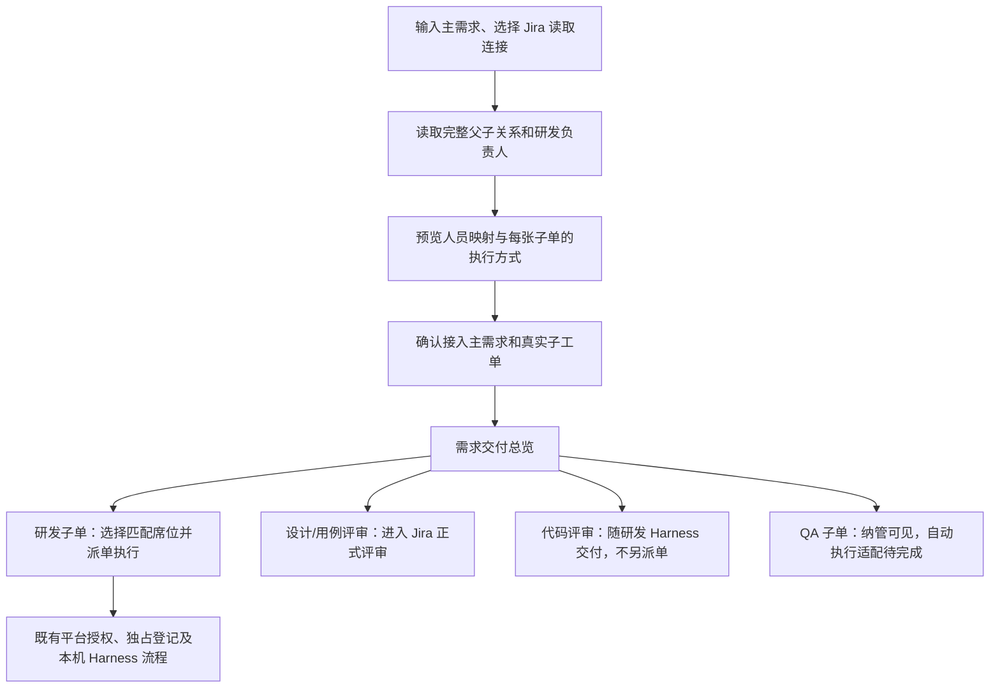

# Jira 主需求交付协同与 Harness 职责整改

日期：2026-10-24
状态：主子单纳管与研发派单已本地实现、定向验证通过，尚未发布；QA 自动执行和证据聚合待实现。

2026-10-25 设计修订：正式代码评审改为独立子单、独立会话，调用研发 Harness 专门评审技能。下文“已实现”及验证结果记录此前实现，代码评审拒派仍是旧实现行为；独立评审派单尚待开发，不能将本文的目标职责视为已上线。

## 1. 修正后的职责

主需求以 Jira 研发负责人为协调人；子工单以其真实 Jira 经办人关联平台人员和席位。开发组与测试组的组织汇报关系不决定需求交付关系。同一交付管理组织下，通过项目及真实主子单汇总交付；不会自动迁移现有 DSP、基础平台、ATS2.0 组织，也不跨公司查询或授权。

主需求只作为协调容器，不给 Agent 执行、不累加一份虚构工时、不向 Tracker 另造主单交付记录。

| 子单 | 执行方式 | 门禁及证据 |
| --- | --- | --- |
| 系统设计 / 系统设计补充 | 研发席位，jira-design-doc | 按研发 Harness 原有设计流程 |
| 设计评审 | 对应负责人的人工评审 | Jira 正式评审记录；网页普通评论不能代替 |
| 编码 / 前端编码 | 研发席位，jira-feature-dev | 编译、测试及编码自检；交付明确的待评审提交范围 |
| 代码评审 / 编码评审 | 平台独立派发真实评审子单，目标研发席位开启独立会话调用专门代码评审技能（待实现） | 仓库、基准/目标提交 SHA、评审报告、问题清单、结论及独立 Tracker 回执 |
| 详细测试用例编写 | 测试席位，jira-testcase-writing | QA 原生模式与人审门禁 |
| 测试用例评审 | 指定人员 | 明确用例版本及正式评审结论 |
| 功能测试 | 测试席位，jira-testcase-execution | QA 环境、构建和用例等原生门禁；不能把此单冒充用例编写单 |
| 未知类型 | 仅纳管 | 不猜测技能、不自动执行 |

**正式代码评审与编码分为两次任务、两次会话，仍使用研发 Harness。** 编码保留自检，正式评审由平台按真实评审子单经办人匹配席位，调用专门评审技能；可以是原研发席位顺序执行，也可以是另一研发席位，无须新增席位职责类型。评审不通过则返回编码修复，再对新提交复审。多个编码和评审子单的范围关系须明确核验，不能仅凭同父关系自动完成。详细契约见[独立代码评审设计](2026-10-25-jira-evidence-driven-delivery.md#12-独立代码评审任务与技能2026-10-25-修订)。

## 2. 已实现的交互与 API（修订前实现记录）

入口：工单 → 接入 Jira 工单 → 选择项目 → 接入 Jira 主需求。

所有接口位于 `/api/companies/:companyId/dsp7-seats/:id/jira-requirements`：

- `POST /preview`：借用已有 Jira PAT 连接，只读取；读取研发负责人字段及全部真实子单，返回快照指纹。
- `POST /import`：重新读取并比对指纹，以事务建立真实 `issues.parentId` 关系。根任务分派给研发负责人用户，子单按各自经办人关联用户；不会分派给 Agent 或授予执行权。
- `POST /prepare`：重新校验实际 Jira 父子关系、人员映射、项目、类型、状态与席位规则，将独立研发子单转换为既有 V3 接入申请；随后由网页调用既有平台派单授权接口。

重要兼容要求：准备后的接入申请保持 **backlog 且不分派执行者**。现有本机接入桥在完成独占登记、仓库校验后，才领取实际执行权。申请标题使用既有“Jira 接入申请”发现条件。不得提前设置 Agent 导致接入桥拒绝。

## 3. 安全与一致性（修订前实现记录）

- 沿用当前组织成员、管理员 / 席位负责人访问检查。业务研发负责人不会自动变成平台管理员，也不自动获得其他席位的配置权。跨席位统一派单仍由管理员完成；进一步委派权限需单独实现。
- 主单负责人来自 `PAPERCLIP_JIRA_REQUIREMENT_OWNER_FIELD`，默认 `customfield_14702`；缺失或多个负责人时阻止导入，绝不用经办人替代。
- 人员按 Jira 登录名或邮箱精确关联，不按姓名猜测。无法自动关联的主需求负责人由管理员显式关联，并记录审计。
- Jira 来源由服务器允许列表约束；PAT 只在服务器解析使用，不进入响应、描述及浏览器。
- 完整分页读取子单，超过 1000 或列表不完整时拒绝部分导入。预览与导入之间 Jira 状态、人员、子单变化时要求重新预览。
- 主单按组织、Jira 来源和编号幂等接入。重复接入返回原任务，不覆盖正在执行的状态；现阶段不会自动同步新增或删除的 Jira 子单。
- 已有独立子单仅在组织、项目、来源及父关系一致时复用；冲突时拒绝自动迁移。复用不覆盖既有会话和历史。
- 导入、准备分别记录审计，均明确 `dispatchGranted:false`。最终执行授权仍走原平台派单流程。
- 导入审计保存子单执行角色，平台消费派单授权时再次限制角色，避免通过修改描述将代码评审或 QA 子单变成研发执行项。
- 可编辑描述中的元数据通过共享运行时校验器解析；异常结构、不安全 URL、多个元数据标记均不渲染。

## 4. 展示边界与未完成项

已实现总览：真实主子单、负责人、执行方式、接入时 Jira 状态、当前平台状态、研发派单与正式人工评审跳转。平台状态与 Jira 快照分开显示，不把 Claude 退出等同于验收通过。

以下尚未实现，不能宣称已全链路闭环：

1. **QA 执行通道**：QA Harness 位于 `/Users/leo/work/fingard/qa-harness-infrastructure`，没有现有研发桥所依赖的 `harness/bin/harness`、`jira_confirmation.py`、`dingtalk_notify.py`。仅改 cwd 不足以运行。需要独立 QA 运行时适配，保留原生身份、执行计时、人工评审、Tracker 回读门禁、单执行器锁及中断恢复；本期不提供假可用的 QA 派单按钮。
2. **评审证据聚合**：尚未把研发 Harness `tickets/review-KEY/state.json` 的范围、SHA、报告和独立 Tracker 回执完整同步到平台总览。目前可沿真实 Jira / Harness / Tracker 核对，不从编码完成推断评审完成。
3. **需求增量同步**：新子单、人员或状态变化应提供显式预览差异与更新机制，不覆盖既有执行绑定。
4. **跨团队委派与自动依赖调度**：研发负责人对需求范围内其他席位的操作权、设计评审完成后的自动流转、测试构建环境准入尚需单独完成。现有组织权限不能被业务负责人字段绕过。
5. **主需求验收闭环**：不自动关闭主需求；需实际交付证据、人审结果及独立回执后提供验收清单。

## 5. 验证（修订前实现记录，不覆盖独立评审新设计）

本轮使用模拟 Jira HTTP 响应和数据库接口测试，不修改真实 Jira，不启动真实业务工单，不修改现有席位登记。

- 服务端：17 个定向测试通过，覆盖完整父子身份、负责人来源、指纹变化、未知类型、恶意元数据、授权、无密钥泄露、代码评审拒派、导入幂等，以及未分派的研发接入准备。
- 前端：3 个新增定向测试通过，覆盖代码评审无二次派单、QA 不冒充已支持、无效描述不渲染；另有 107 个已有席位相关 UI 测试通过。
- 共享类型构建、服务端 TypeScript 检查及编译、UI 类型检查及生产构建通过；token gates 通过。
- 额外尝试席位停止 / 自动重试回归，其中 1 项通过、29 项数据库用例因嵌入式 PostgreSQL 探测不支持而自动跳过，不能视为这些数据库用例已通过。未运行仓库全量测试、Rust runner 重建及真实浏览器 / 真实 Jira 端到端执行；本轮未部署上线。

## 6. 后续设计补充（2026-10-25）

证据聚合与自动依赖调度的后续设计见 [基于 Jira 交付证据的依赖核验与自动流转](2026-10-25-jira-evidence-driven-delivery.md)。各环节交付物已经上传 Jira，后续应以已有附件、完成评论和正式评审记录为主要依据，补充统一交付索引，不要求向平台重复上传一套文档。业务准入与 Tracker 上报状态分别处理，沿用研发和 QA 各自门禁。此补充为待实现设计，不改变本文此前的实现与验证状态。

轻舟层级及计划来源的进一步修正见 [轻舟需求条目与智研平台执行协同设计](2026-10-25-qingzhou-demand-orchestration.md)。需求条目以轻舟为顶层管理对象，原有 Jira 主子工单纳管仍作为执行关联的一部分；不要求为设计与编码额外划分席位职责类型。

独立代码评审后续实现需增加明确的评审执行角色及技能路由，替换旧的代码评审拒派规则；仍禁止将评审子单伪装成编码单。更新服务端、前端、接入桥和 Harness 后重新验证，旧测试结果不能证明新链路可用。

## 工程细化及真实样本补充（2026-10-25）

后续实现统一参考[轻舟交付协同工程细化设计](2026-10-25-delivery-orchestration-detailed-design.md)，包括跨系统差异、范围回退、权限、同步、数据/API、运行、风险、通知、统计、页面和升级验收。真实历史依据见[ATS3-00156 样本报告](2026-10-25-ats3-00156-lifecycle-analysis.md)。补充属于待实现设计；旧实现的代码评审拒派测试不证明独立评审已经支持，也不以已完成历史样本验证自动执行链路。

## 需求分析前置环节补充（2026-10-25）

现有 base-harness-analysis-suit 已具备 DSP 分析生命周期，平台将以独立分析执行项接入，允许分析发生在 Jira 主子单生成前。主单继续作为协调容器，分析不伪装成研发编码子单；与正式需求评审、轻舟拆单及后续系统设计的衔接见[分析接入设计](2026-10-25-analysis-harness-integration.md)。此处为目标设计，不扩展此前已实现 Jira prepare 的执行范围。
