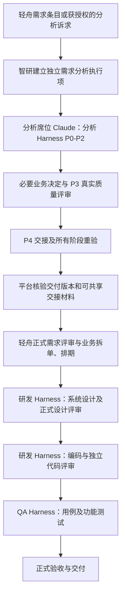

# DSP 需求分析 Harness 接入与交付衔接设计

日期：2026-10-25。状态：已核对现有套件，平台接入待实现；不代表已上线或已完成真实分析任务验收。

关联：[轻舟协同设计](2026-10-25-qingzhou-demand-orchestration.md)、[工程细化设计](2026-10-25-delivery-orchestration-detailed-design.md)、[交付证据与独立代码评审](2026-10-25-jira-evidence-driven-delivery.md)。本补充把需求分析纳入独立 Harness 执行能力，替代“平台只读取已有分析结果”的范围限制；轻舟仍是正式业务流程来源。

## 1. 已核对的仓库事实

主入口：`/Users/leo/work/fingard/base-harness-analysis-suit/CLAUDE.md`。本次读取了 AGENTS、工作流、架构、目录/续传、产物契约、DSP 环境说明、通用/领域/续传技能、profile 及 `analysis.py`。本地分支为 `dsp`，HEAD 为 `9a9e143ba4116e37f272bd3ee7bd65b139bf1a42`，实际未提交改动仍以文件内容为准。执行 `python3 harness/scripts/analysis.py check` 通过，仅证明技能/profile 结构可加载，不证明完成业务分析或平台桥适配。

| 项目 | 当前套件事实 |
| --- | --- |
| 通用入口 | `requirements-analysis` |
| DSP入口 | `dsp-requirements-analysis`，先加载通用入口，按 profile 选择领域技能 |
| 续传 | `analysis-resume`，先读取已有任务状态，不重新 init |
| 默认 profile | active.json 指向 dsp，dsp.json 保存路由和本机路径默认值 |
| 领域技能 | dsp-doc-extract、dsp-kb-routine-ops、dsp-interface-mapping；按输入需要选择，不要求每单执行全部技能 |
| 持久化 | `工单/analysis-<ID>/state.json` 为唯一阶段状态；progress.md 为追加日志 |
| 本地环境 | Python 3.9+、Git；生命周期 CLI 使用标准库，文档解析依赖按需准备 |
| 已有能力 | 原件来源/哈希、证据与需求引用、问题阻塞门禁、真实评审、输入指纹失效检查、断点续传 |
| 尚无能力 | Jira/Tracker 自动写入、原生执行计时/自动 Git hooks、平台任务领取、决策消息接收与运行回报适配 |

任务材料与本地环境配置默认 Git 忽略；git pull 共享框架和技能，不等于自动同步分析原件、客户知识库、评审或交付包。

## 2. 流程位置及三类 Harness



上图表示新任务的目标流转。已有轻舟分析和正式批准继续纳管，不批量重跑。P3 与轻舟正式评审如使用同一真实评审活动，需显式关联同一版本和正式记录并核验；不可默认二者等同，也不机械要求同一人重复评审两次。

| 领域 | 回答的问题 | 仓库 |
| --- | --- | --- |
| 需求分析 | 为什么做、做什么、业务规则及如何验收 | base-harness-analysis-suit |
| 研发设计/实现/代码评审 | 技术上怎样设计、实现是否正确 | base-harness-infrastructure-dsp7 |
| 测试 | 用例覆盖及目标构建是否满足需求 | qa-harness-infrastructure |

独立代码评审仍按既定方案使用研发 Harness 的专门技能，不迁入分析套件。分析交接中的建议任务与工作量假设不等于轻舟已正式确认的拆单和排期。

## 3. 分析任务身份和执行授权

分析发生在 Jira 主子单生成之前，因此不能强制要求 Jira key、研发子单类型、Jira 经办人/开工状态或研发桥 `register-replay`。

新增独立分析执行项，建议角色 `requirements-analysis`；角色不是席位人员类型。身份包含公司、项目、轻舟来源/条目 ID/分析记录 ID（存在时）、平台分析任务 ID、分析修订和本地任务 ID。没有轻舟/Jira 编号时允许平台分析任务，后续以显式关联接入真实条目，不伪造 Jira 子单。

- 条目和 Jira 业务主单仍是协调容器，不直接派给 Agent。分析工作对应独立可执行记录，关联条目，不把主单编码身份复用为分析身份。
- 责任人优先使用轻舟需求分析人员，经人员联邦外部身份映射至平台用户；无来源时由有权人员指定分析负责人。主单研发负责人、拆分人不自动成为分析负责人。
- 首期由管理员在智研发起并明确授权；后续委派按条目/项目和动作范围控制。轻舟分派、浏览器登录或读 PAT 不自动授予执行权。
- 一个负责人有多个合格席位时沿用项目默认席位/显式选择；可在同一物理席位登记多类 Harness 能力，任务固定本次使用的 Harness，不新增“分析席位类型”。
- 新分析修订默认不继承原执行授权，除非原授权明确允许该范围内的修订。历史 ATS3-00156 仅作观察样本，不因新增能力自动重跑。

本地任务 ID 使用确定性、合法且不含客户敏感信息的标识；建议由平台分析任务 UUID 与修订生成，满足 CLI 的 `[A-Za-z0-9][A-Za-z0-9_.-]{0,99}`。平台保存映射，不能仅凭标题拼目录。同条目可有多个修订，不能直接以条目号覆盖旧交付。

## 4. P0-P4 的门禁、回报与显示

| 原生阶段 | 当前门禁 | 平台展示及依赖 |
| --- | --- | --- |
| P0 接收 | intake.md 有实际内容，非空模板 | 接收中；明确背景、对象、范围和材料来源 |
| P1 证据 | evidence.json 至少一条唯一证据，来源/定位/时间完整，file 原件哈希相符 | 整理证据；分别显示已取证和材料缺口 |
| P2 分析 | analysis.md、requirements.json；需求引用有效证据、具体验收；阻塞问题已解决 | 分析中或等待业务决定；显示 R/E/Q 覆盖及缺口 |
| P3 评审 | review.json 的真实 reviewer、reviewed_at、decision=approved、input_sha256 与当前输入一致 | 待质量评审/已通过/评审失效；不自动等同正式业务审批 |
| P4 交接 | handoff.md 完整，重验所有历史阶段和评审输入 | 交接待核验；全阶段有效且 status=completed 后才是本地分析完成 |

原生状态只有 `in-progress / completed` 和 P0-P4，平台的“等待人/等待资源/停止/失败”是运行维度，不写成套件不存在的原生阶段。检查失败只能报告缺口，不由平台修改 state.json 跳阶段。

重要实现事实：`analysis.py status` 即使打印非空 `gate_errors` 也可能退出码为 0，必须解析状态身份、completed_phases 和 gate_errors，不能只看进程退出码。state.json 自报 completed 同样不够，需运行 status 重验并确认无门禁错误。

P3 输入指纹覆盖 intake.md、evidence.json、requirements.json、analysis.md 及 file 原件摘要，不包含 handoff.md。平台交付清单需另算 handoff 与所共享产物的摘要；不能宣称原生 P3 已审批整个交接文件或新增拆单建议。外部证据 kind=external 没有本地哈希，按真实 URI、环境、定位和时间保存，不捏造摘要或把只读查询意图当已取证。

## 5. 本机启动、续传与环境登记

以下为已核对的原生命令形态，在席位登记的分析 Harness 根目录执行；参数通过进程 argv 传递，不拼接用户输入为 shell 命令。

```text
python3 harness/scripts/analysis.py check
python3 harness/scripts/analysis.py --tasks-root <登记的任务根目录> init <本地任务ID> --title <任务标题> --profile dsp
python3 harness/scripts/analysis.py --tasks-root <登记的任务根目录> status <本地任务ID>
python3 harness/scripts/analysis.py --tasks-root <登记的任务根目录> fingerprint <本地任务ID>
python3 harness/scripts/analysis.py --tasks-root <登记的任务根目录> advance <本地任务ID>
```

由受管 Claude 加载 CLAUDE.md 和 dsp-requirements-analysis 推进领域工作，不是平台循环执行 advance 自动生成分析。已有任务先 status，再加载 analysis-resume 续传；不得重新 init 覆盖证据。

席位配置分为：

- Harness 身份：稳定仓库标识、登记根目录、profile、框架/技能版本、Python 解释器和任务存储根目录。
- 资料环境：DSP_WORKSPACE、DSP_KB、DSP_MEMORY、DSP_SOURCE_ROOT，以及可用只读连接器/文档解析工具；实际根目录逐席位登记，不硬编码为管理员电脑路径。
- 业务源码映射：源码只是分析依据，不与分析 Harness cwd 混淆。默认相邻 `../dsp7.1_git` 只是 profile 默认；需实际检查仓库、ref/commit 和文件定位，不自动 checkout/reset。

本机知识库初始化不等于拥有服务器历史客户资料，缺材料如实报告。已有 skill/check 不验证全部文档解析依赖和生产连接器；新增能力握手分列“结构就绪”“本地资料就绪”“外部只读连接可用”。

分析套件只有任务目录排他锁，尚无平台单执行器或跨席位分析独占登记。桥适配需补充公司/分析任务/修订的领取独占与席位互斥，保留原有 `.lock`。遗留锁需先证实无活动写进程，由负责人按诊断流程处理，不自动删除。没有原生 resume/cancel CLI，续传通过 status/技能，停止由平台受管进程控制，先确认旧进程停止再启动。

## 6. 决策、评审与权限

套件规则是：用户已明确的要求直接执行；仅业务冲突、必要事实缺失或显式要求评审时收集决定。平台不新增逐阶段人工确认来阻止正常 P0-P2 推进。

questions 映射为结构化决策：分析任务/修订、Q-ID、阻塞性质、问题内容版本、来源及负责人；resolved 需保留 answer、决定来源与回报。网页回复经受管会话可靠送达，Agent 按真实答复更新材料并运行门禁；消息 ACK 只代表送达，不等于问题已正确解决或业务已批准。

套件当前不自动读取 Jira 确认评论，也无平台回调。新增桥应通过平台决策通道发送上下文并接收回执，不能假设现有 analysis-resume 已监听网页消息。未接通时清楚显示需在会话提供明确决定，不宣称线上闭环可用。

P3 可由明确标识的真实分析评审者进行质量评审，不一律要求业务批准人；缺少业务事实/决定仍不能用质量评审放行。轻舟正式评审若要求指定人员和角色，则另行核验该正式活动。平台可关联真实用户明确作出的评审，但普通“同意”不能被自动解释为批准所有未来版本。自动生成 reviewer、时间和 approved 草稿不构成真实审签。

材料修改后重新计算输入指纹，旧 P3 结论失效；已交付任务变更按套件建议建立关联的新分析任务/修订，保留旧基线，不手改 state.json 或虚构 reset 子命令。交接补充变化也需重新核验共享清单；涉及需求/验收范围变化时重做对应评审和正式流程。

只读查询权限、本地知识库写入、正式 Jira/轻舟写入和外发授权分别处理。套件领域技能可能维护本地知识库；开启前预览写入范围，不扩大为对客户数据库或生产环境的写权限。分析执行授权不是发送钉钉消息、写外部工单、部署或运行数据库变更的授权。

## 7. 交付清单与研发衔接

沿用已有产物，不另造一套需求正文：intake.md、evidence.json、analysis.md、requirements.json、review.json、handoff.md，以及经授权共享的来源索引/原件。平台只保存必要索引及核验结果，本地 state/progress 和原始客户材料不默认整目录上传。

候选交付清单字段：schemaVersion、analysisTaskId、revision、supersedes、demandRef、profile、Harness/技能版本、localTaskId、runId、原生 phase/status/gateErrors、reviewInputSha256、逐产物 path/hash/共享引用、requirements/evidence/questions 摘要、reviewRef、handoffHash、collectTime、外部发布状态。

文件路径必须任务目录内且验证安全，相对引用可迁移；原件读取遵循套件路径/哈希校验，不能引用另一席位不可访问的绝对路径作为已共享证据。R-ID 保留其原生身份；验收 ID 可由 analysis.md 的显式 R1-AC1 等引用，不能假设 requirements.json 已有独立 AC-ID 字段。

外部发布状态分开：local_completed、publication_pending、published、publication_failed；这些是平台投影，不添加为原生 state.status。当前套件没有上传器，需新增发布适配器并经授权后才能写入轻舟/Jira；未核实接口前允许管理员按正式流程上传，再登记实际引用并回读核验。平台能看到本地摘要不等于研发已取得交接包。

进入正式拆单/研发前至少满足：

1. 本地 P0-P4 当前有效、无阻塞问题，真实质量评审版本匹配。
2. 若正式流程要求轻舟业务评审，取得该活动通过及适用版本证据；不以本地 completed 代替。
3. 所需交接材料可由目标人员/席位按权限访问，记录不可变共享引用与摘要；缺少允许共享的材料时等待发布，不在主单描述里粘贴整套原件。
4. 拆单建议在轻舟正式确认，平台同步真实主子单、计划及对应需求/验收覆盖关系。
5. 研发运行授权、席位、仓库及原有设计准入有效。分析完成仅触发后续核验，不绕过系统设计、正式设计评审、独立代码评审或 QA 准入。

需求分析版本与多个业务主单可以一对多；各主单依赖具体 R/验收范围，不按同条目自动全部关联。需求变更先生成影响清单；对未开始任务使旧准入失效，对运行中任务通知负责人按已配置策略处理，不一律杀进程或重跑全部交付。

## 8. 平台工程增量

在工程细化文档第 6 节逻辑模型上增加，均为候选结构：

| 实体/契约 | 增量 |
| --- | --- |
| analysis_executions | company/project、demandRef 可空、平台任务、revision、localTaskId、分析负责人、选定能力/席位、授权与运行；不依赖 Jira key |
| analysis_deliveries | 原生阶段/门禁快照、评审指纹、交接清单及发布引用、修订替代关系 |
| Harness 能力登记 | 稳定 Harness ID + 领域 + profile + 技能/协议版本；本机目录由席位映射；同席位允许多能力 |
| 外部来源映射 | 轻舟条目/分析记录与平台分析执行项关联；保留 Jira 非必需的源类型 |
| 依赖模型 | 分析有效交接及正式需求评审 → 真实拆单/排期 → 对应研发设计/实现；保留原有研发/QA规则 |
| 决策与风险 | 复用 delivery_decisions 但保存分析修订/Q-ID；质量评审和正式业务审签类型分开 |

建议候选 API：在 `/api/companies/:companyId/delivery` 下新增 `POST /analysis/previews`、`POST /analysis/executions`、`GET /analysis/executions/:id`、`POST /analysis/executions/:id/dispatch`、`POST /analysis/executions/:id/deliveries/verify`。创建仅建立记录，派发仍需显式授权、幂等 requestId、版本复核和独占权；未有 Jira 不应调用现有只接受研发 Jira 子单的 prepare 接口。

事件协议增加 analysis.phase_observed、analysis.gate_checked、analysis.question_opened/resolved、analysis.review_observed/invalidated、analysis.delivery_collected，绑定任务/修订/run/序号。它们是待实现回报协议，不声称套件已存在这些 hooks。通过桥在 CLI/受管会话边界采集，不能只监听 state 文件就推断真实运行中、等待人或评审来源可信。

计时和 Token 从受管运行采集，套件没有的 Tracker 回执显示未接入，不伪造 0h/0token 或照搬研发上报格式。若要接 Tracker，应先定义分析任务的外部身份、数据类型和独立回执契约，不能冒用编码单报工。

## 9. 页面与实施顺序修订

工作台增加可筛选“需求分析”环节；条目详情在主单树之前展示分析执行项、P0-P4、阻塞问题、质量评审/正式评审、交接修订与发布状态。未拆出 Jira 工单时不显示错误“未登记试点工单”。创建分析任务入口提供轻舟条目关联/无条目的分析任务，已有任务提供续传，不提供覆盖初始化。

席位负责人在自己的“执行能力”登记分析 Harness 本机目录、profile、任务根和材料环境；管理员设置项目允许的仓库/能力与负责人，网页不把本机路径配置成所有人的共享路径。未适配客户端只展示升级/配置提示，不显示可用的分析派发按钮。

实施顺序为：A 轻舟只读/差异纳管继续推进；并行设计落地分析任务身份及能力登记。新增 A2 完成分析适配器与单席位试点，再接 B 证据/正式评审/交接准入；C 独立代码评审、D QA、E 通知统计验收依原计划推进。原有分析已完成的需求可先走只读关联，不必等待新套件任务重跑。

### 验收重点

- check 成功与业务完成分开；无 Jira 的合法分析任务可建立并执行，但不造假 Jira 身份。
- init 不覆盖、status/analysis-resume 续传；status 退出0但 gate_errors 非空时不放行。
- P0-P4 真正执行，原件哈希错误、缺证据、缺验收、未解决阻塞问题均失败；不改 state 跳阶段。
- P3 真评审及指纹匹配；输入改变旧批准失效；质量评审不冒充业务批准。
- handoff 独立哈希；本地完成但发布失败/权限不足时不能让研发读取不存在的共享产物。
- 同席位多 Harness cwd/解释器/profile 不串用，分析源码只读，不改生产数据；多席位共享任务禁止双写。
- 网页决策可靠投递、陈旧问题不执行、Agent更新材料后重验；不假设原套件已有评论监听。
- completed 的修订不覆盖历史；无计时/Token/Tracker来源时标缺失，运行回执不等于原生领域通过。
- 未配置桥适配及外部上传契约时只展示明确的待接入状态；旧研发席位和运行中任务不受影响。

本次只更新 Paperclip 设计文档并执行套件结构 check，未修改分析套件、初始化业务分析任务、运行 Claude、改动 Jira/轻舟或上线服务。


实现拆分及迭代依赖见[未完成能力实现设计](2026-10-25-unfinished-delivery-implementation-design.md)。分析最小决策链路前置到 I2，不等待管理报表全部完成；轻舟服务认证未打通时可先试点无 Jira 的独立分析，但正式交接/拆单仍遵守源系统流程。


预算治理补充：所有新增分析/研发/独立评审/复审/QA执行均继承原生公司/项目/agent预算，派单、领取及恢复重复校验，超限保留真实远程停止与用量回执；预算恢复不等于执行授权或领域准入。完整设计及能力边界见[交付预算治理](2026-10-25-delivery-budget-governance.md)，此处为待实现合同，不宣称现有桥已受控。


## 2026-10-25 P1 实现进展补记

独立分析的网页任务、显式派发、本机可见 Claude、版本化决定回传和原生产物索引已实现，并完成隔离真实 Claude 闭环验证。正式发布为人工核验登记，尚无上游自动发布／回读。已于 2026-10-26 发布生产，服务、迁移、静态资源及客户端包核验通过；浏览器验收仍因 ego lite 空间接口无响应待完成。详见 [生产发布记录](2026-10-26-p1-analysis-production-release.md)。实现范围、回归结果及剩余边界见 [P1 实现与验收](2026-10-25-p1-analysis-execution-implementation.md)。本节更新开发进展，不将本文其他规划能力一并标为已完成。
