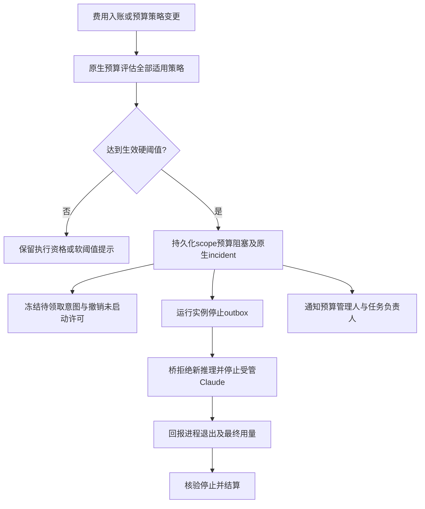

# 交付执行的原生预算治理补充设计

日期：2026-10-25。状态：已核对现有源码的待实现设计；预算桥接、计费去重和新领域治理尚未完成。本次不调整实际预算、不停止现有任务、不发布服务。

关联：[工程细化设计](2026-10-25-delivery-orchestration-detailed-design.md)、[开发拆分](2026-10-25-unfinished-delivery-implementation-design.md)、[分析 Harness](2026-10-25-analysis-harness-integration.md)。本补充将预算治理设为新执行路径的前置要求，而非最后增加一个费用报表。

## 1. 已有事实和待补能力

核对来源：`server/src/services/budgets.ts`、`costs.ts`、`heartbeat.ts`、`server/src/routes/costs.ts`、`packages/db/src/schema/budget_policies.ts`、`cost_events.ts`、`ui/src/api/budgets.ts` 及现有本地桥派单路径。

| 事项 | 源码事实及边界 |
| --- | --- |
| 原生预算范围 | company、agent、project；不等于已支持条目/主单/分析修订预算 |
| 生效指标 | 当前主要为 billed_cents；不能把Token配额或模型调用次数上限写成已有硬预算能力 |
| 窗口 | calendar_month_utc、lifetime；预算月为UTC月，不随组织报表时区改变 |
| 默认值 | policy金额≤0不构成有效限额；默认预警比例80%，硬停止与通知可配置 |
| 消费入账 | costService.createEvent写入cost_events并触发预算评估；月花费字段是汇总，不是新独立账本 |
| 超限 | budgetService暂停scope，借助可选cancelWorkForScope hook取消工作；无hook的调用不能被描述为已取消所有远程进程 |
| 开工检查 | heartbeat调用getInvocationBlock；自定义桥及新领域路径需接入，不保证天然覆盖 |
| 处理事件 | 支持raise_budget_and_resume及保持暂停的处理；提高限额须大于当前观测消费 |
| 范围恢复 | 原生有清除budget暂停的路径，不能据此推导多个范围/策略都已放行，也不能自动重启被取消运行 |
| 现有API | GET /api/companies/:companyId/budgets/overview；POST对应budgets/policies及budget-incidents/:incidentId/resolve |

多个有效窗口可同时作用于同一范围。新路径需检查所有适用策略；当前getInvocationBlock对每种scope选取首条策略，不能单独作为多窗口已完整检查的证据。实施时在原预算服务中统一补齐适用策略评估，再供原生和桥路径共同调用，避免另一套算账逻辑。

## 2. 核心约束与默认行为

1. 所有平台授权执行都受公司、项目及执行agent三层检查；任何一层阻塞均不能领取。条目/主单为成本归集维度，不新增第四份消费。
2. 同席位多个Harness共享其agent预算，独立评审、复审和QA产生的真实费用分别归真实运行，不因角色不同绕过限额。
3. 原生amount=0/未配置有效policy表示未设置限额，不改成零元封禁。页面显示“未设置限额”，不能标为已受预算保护。
4. 软阈值仅提示；硬停止生效才拦截新推理、停止/取消受影响运行。只读同步、查看证据、接收回复、控制与交付回报不消耗推理预算，不因budget暂停关闭这些通道。
5. 预算治理仅约束经平台登记和授权的运行，不能控制用户在平台之外自行启动的Claude；此类消费不得被声称已计入或受限。
6. 预算不等于执行授权；提高预算不允许扩大派单范围或绕过正式领域门禁。管理员派单权不自动等于修改预算或批准业务风险的权限。

项目首期只复用原生三层费用预算。单工单Token/费用限额、修复次数和运行时长属于可配置的额外执行约束，若尚未开发必须显示未启用，不拿修复轮次代替费用预算。

## 3. 接入位置与开工原子性

新增统一的执行准入服务，返回领域准入、授权、手工暂停、预算及运行独占的合并结果；预算明细仍来自budgetService，不让每个路由复制SQL。

| 检查点 | 行为 |
| --- | --- |
| 预览/授权 | 展示当前预算范围、策略与消费完整性；授权可保存，但不得显示已运行 |
| 生成派单意图 | 读取全部适用策略和scope暂停；不通过保存等待预算的意图，不向可领取队列发布 |
| 席位领取 | 再读项目、agent、公司、策略/暂停版本和范围，原子绑定一次有效运行许可 |
| Claude启动前 | 验证许可、预算决策版本及有效期；过期/撤销不得启动，网络失败等待验证 |
| 每次新阶段/复审/重试/恢复 | 重新准入；不复用原运行的预算结论获得第二次开工权 |
| 费用事件及周期对账 | 实际入账评估阈值，触发scope暂停、取消/停止及通知；漏事件补报同样重评估 |

候选budgetDecision字段：scope列表、policyId/window/amount/observed、策略版本或updatedAt指纹、账本快照标识、计费完整性、检查时刻、expiresAt、blockers。响应只是瞬时判断，不是长期消费保证。

并发领取按公司→项目→agent的固定锁顺序协调预算许可与派单意图，并以requestId唯一关联；不能持锁等待外部API。只锁并读取已发生消费仍无法防止多运行同时烧掉剩余额度，因此严格并发控制需要在同一事务中核对“观测费用＋未结算预留”，见第4节。

## 4. 并发预留、计量不确定性与承诺边界

原生按已发生费用检查，不保证精确零超支。新增治理明确区分：

- 观测费用硬停止：达到已知阈值即拒绝新运行并发停止；可因上报/取消延迟和在途请求产生尾部费用。
- 有界运行预算：仅在适配器能限制一次推理/运行最大消费且计费来源可靠时启用预留；不能仅用估算宣称严格消费上限。
- 无法精确计费：明确显示计费缺失/估算。启用了硬预算且计费路径未验收的项目，不开启新自动执行，先完成计量适配或由有权预算管理人显式调整策略并记录审计；不能以cost=0掩盖问题。

候选执行许可/预留表字段：company/project/agent、policy/window、request/run、reservedUpperBound、expiresAt、status、settledCost、settlementRevision、stopReceipt。一次运行对不同scope的预留用于各scope检查，不记成多笔实际费用；scope按各自剩余额度检查。

有界预留只接受可核验的上限，原子检查observed＋所有有效未结预留＋本次预留≤各策略限额。随着实际事件入账，同事务结转对应预留，保留剩余未上报部分，不能把已入账部分再计一遍。若适配器不能提供上限，reservation标为不可用，不伪造估算上限；可按显式策略限制并发及单次推理，但应展示观测费用模式的实际边界。

许可到期不能证明远程进程已停，也不能直接释放全部预留给新运行。先确认未启动或已退出并完成费用对账；失联的未决费用保守保留并通知负责人。预留不是原生cost_events的一部分，新数据模型和结算服务需单独迁移、权限及并发测试。

## 5. 真实费用、Token和去重

本地Claude可能使用API、中转或订阅。保存provider/model/biller/billingType/costStatus及计费来源；费用计价遵循现有账本货币单位，不能将人民币中转价格或模型官方标价直接混加成同一币种。币种/汇率/计价版本未明确则标未计价。

Token和费用分别采集：已知Token不代表已知费用；订阅包含量不等于平台已知真实零成本。估算作为单独展示数据，不能伪装reported费用事件；合法实际零费用和缺失值区分。需要估算治理时另经明确策略支持，不悄悄改变原生billed_cents口径。

原生costService.createEvent本身不提供所有外部事件的通用幂等保障。新增桥计费入口必须验证公司/席位/真实run绑定、计费字段和producer协议，按provider事件ID或run＋来源＋序号＋修订产生唯一键；内容冲突拒绝，重复事件只返原回执。run结束汇总与流式用量不能双记，需声明累计/增量模式并由服务端计算可信差量。

cost_events是统一实际账本；领域报告、Tracker和受管消息只作来源或索引，不各自再写一份相同费用。对账补报按真实occurredAt归入原窗口；晚到的上月费用保留上月记录和事件，不拿本月任意一笔冲销。费用更正需明确不可变来源和修订合同，首期不开放客户端任意负数抵扣。

每个真实执行run必须关联公司、agent、项目及叶子任务；分析无Jira时关联平台分析任务即可。任务后续改派不迁移历史agent消费，不把条目/主单重复算作新运行。私有会话正文、PAT和API key不进入账本或预算通知。

## 6. 超限暂停、远程停止与异常

沿用原生“暂停范围并取消工作”的语义；远程停止通过既有控制通道，不能只更新heartbeat run状态就宣称本机进程停止。新费用入口或预算策略变更所使用的budgetService必须连接统一cancelWorkForScope hook，hooks产生可持久重试的取消/停止意图，而非仅操作服务端内存进程。

本地桥在下次可观察推理边界拒绝新增调用，对正在执行的受管进程立即走已有停止流程；不等Agent主动完成当前业务阶段。若适配器只暴露整个CLI进程，就停止该进程，保留已写磁盘证据；不得为了“保存现场”另开一次付费推理。Jira不标业务完成，原生阶段不跳转。

调度意图标budget_blocked；运行记录使用现有受支持cancel/stop状态并附stopReason=budget。页面分别展示“预算已暂停”“本机停止待确认”“已停止，可在预算恢复后续传”。没有退出回执保持停止核验，不另起执行器；旧版本桥若无可靠远程停止能力，不能启用声称支持运行中硬停止的新流程。

断网保护：预算受控的新执行需有带版本和有效期的本地许可，桥定期续验，过期停止新推理并按既有失联策略终止受管进程。推荐许可有效期60秒、20秒续验，作为可配置建议且需验证时钟偏差/进程重启语义；服务端以自身时间发放，本地使用单调计时限制剩余有效期，不能靠回拨时钟延长。该机制不撤销已发往第三方的在途推理或已经产生的费用。

不把断网、停止失败或客户端订阅消费不可见包装为保证零超支。试点发布说明需展示观察模式、预留能力及最大允许控制延迟，并以实测结果验收。

## 7. 恢复、审批与多重阻塞

复用原生预算事件和处理接口，不另造一个普通“同意”来绕过预算审批。预算管理权限沿用现有costs路由授权，并对新增桥/调度路径做相同检查；交付协调人若只获派单委派，不因此可以调高预算。

| 操作/变化 | 目标行为 |
| --- | --- |
| 提高预算并恢复 | 原生验证新限额大于当前消费；更新预算后重新检查所有scope、所有窗口及预留、手工暂停和领域门禁 |
| 仅修改策略或禁用限额 | 保留原生行为并审计，但重新核验合并阻塞，不把scope字段刚被清除视作全部运行可恢复 |
| 保持暂停/关闭事件 | 不恢复执行；dismissed不等于消费未超限 |
| 月度窗口切换 | 新窗口重新计算；原有暂停不得被调度器擅自清除，需按有权预算恢复动作/明确配置策略处理；首期默认不自动恢复 |
| 原生范围恢复 | 仅解除预算原因；手工暂停、撤权、席位离线、材料失效、运行未确认停止均继续阻塞 |
| 用户点击任务恢复 | 重新检查预算、授权、源版本、适配能力和旧执行器已停，再复用原生续传入口；不是重跑已交付子单 |

原生scope字段只有单个pauseReason，不能表达全部并存条件。新调度维护可组合blockers并校验变更版本；实施时保护预算修改与人工暂停并发，不能由budget恢复覆盖更晚的手工暂停。清除一个incident不清除其他policy或scope的预算阻塞。

对于预算停止的待领取任务，恢复后可在原有效自动流转授权下重新计算/排队。已中断运行首期默认由有权人员点击“恢复执行”；允许自动续传时须在原授权中明确、保持同任务/修订及合法恢复身份，并再次核验旧进程和费用，不默认重播所有被取消队列。

## 8. UI、通知与治理可见性

工单主状态增加“等待预算”，附公司/项目/席位范围、窗口、已知消费/限额、计费完整性、尚未结算的在途用量和下一步。业务完成率不因预算暂停增加；硬停止不能显示为业务失败已交付。

预算管理入口复用原生费用/预算页面，提供深链和按权限显示的“调整预算并恢复”。任务详情显示当前阻塞列表和停止核验结果；只拥有任务执行权的人可查看必要摘要，不能获取超出权限的其他项目用量或密钥。

软阈值通知预算管理人；硬阈值同时通知管理人、受影响席位负责人及协调人摘要。复用原生incident作为事件源与既有钉钉/站内通道，按policy/window/threshold/接收人去重，不因每个Token事件发一次提醒。外部发送授权/机器人来源沿现有配置，无配置则只站内提示。通知被阅读不等于预算获批准。

报表同时显示原生UTC预算窗口和组织业务报表时区；不能因业务报表进入新月就认为UTC预算已重置。原生公司、项目、agent汇总是不同观察维度，不能相加计算全公司费用。

## 9. 工程落点与实施门槛

新增开发包W00“统一预算与计量准入”，与W01领域合同并行，必须在I2任何新领域真实自动执行前完成必要部分，不能等I5报表阶段才补。

| 层 | 待实现内容 |
| --- | --- |
| shared | budgetDecision/blocker/许可/计费来源及停止原因合同，不把计价缺失写为零 |
| db | 外部用量去重收据、必要的许可/预留/停止outbox与版本；cost_events保持统一实际账本 |
| budgetService/costService | 全部适用策略评估、入账幂等集成、原生scope暂停恢复的并发保护及统一cancel hook |
| delivery调度及现有桥派单入口 | 授权保存、意图发布、领取、启动、复审/重试/恢复全部检查；服务端请求不可通过改描述绕过 |
| 本地桥/领域适配器 | 本地许可续验、预算暂停后仍在线回报/接收控制、真实进程停止回执与最终用量 |
| UI/通知 | 等待预算、计费缺失、停止待确认、原生审批/恢复入口及去重通知 |

实现首先完成观测费用治理与可靠停止、明确展示计费能力。严格有界预留只对具备可核验上限的适配器启用；不支持时保持明确模式，不声称通过了严格零超支验收。默认既有任务/客户端继续旧模式，不为它们补造全程预算受控标签。

## 10. 验收清单

1. 公司/项目/agent任一超限拦截全部新角色；同scope多窗口同时受检；amount=0遵循未设限额语义。
2. 手动网页派发、自动依赖派发、旧桥可调用入口、新分析、代码评审、QA、修复/重试/恢复都不能绕过准入。
3. 软阈值仅预警；硬阈值生成原生incident、暂停、冻结队列并触发远程停止；发送/DB状态不冒充退出回执。
4. 重复/累计用量事件不重复计费；流式与最终汇总对齐；缺定价/订阅用量不当零成本；不同币种不混加。
5. 并发领取与策略变更竞态受控；预留结算不双计、许可到期不自动释放未决远程费用；仅可核验上限启用严格模式。
6. 预算停止时文件/阶段/会话可恢复；不跳业务门禁，不把等待人工/停止当完成；停止未确认不得另起进程。
7. 多scope同时暂停只解除已获准部分；保持暂停、手工暂停并发、撤销授权和UTC月切换不被自动解除。
8. 调高限额后重新检查实际费用、预留、权限与领域版本；原生resume scope不自动重跑所有任务。
9. 断网/重启/进程关闭/旧客户端均显示真实控制能力，客户端预算暂停仍可回报心跳、停止及最终计量。
10. 通知去重、权限隔离、不泄露其他项目消费；原生UTC窗口与业务报表时区明确；预算失败依赖保留可审计原因。

完成定义：预算服务定向与数据库并发测试、路由权限/所有入口覆盖、桥受控停止/续传测试、本机与服务器小额受控试点均有结果。未执行的真实计量或提供方取消能力检查必须单列，不以mock通过宣称生产预算控制完成。
