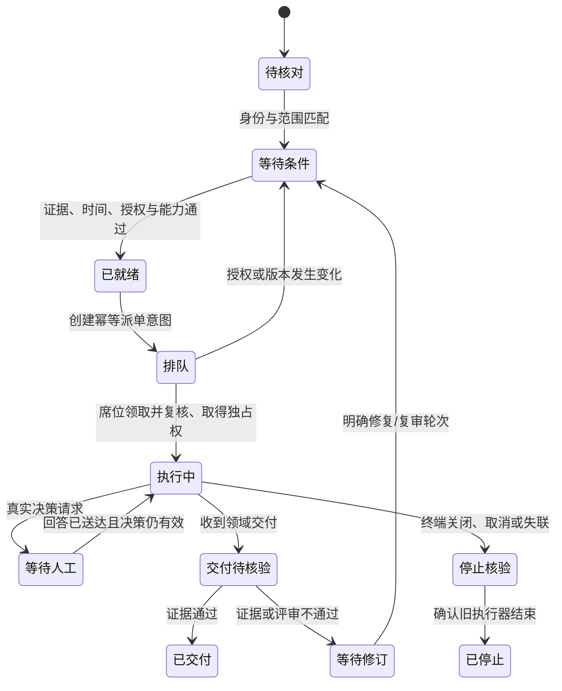

# 轻舟交付协同工程细化设计

日期：2026-10-25。状态：待实现设计；接口、表名、配置默认值均为本方案约定，不代表现网已支持。本次不修改业务代码或发布服务。

上位方案：[轻舟协同设计](2026-10-25-qingzhou-demand-orchestration.md)、[交付证据与独立代码评审](2026-10-25-jira-evidence-driven-delivery.md)。事实依据：[ATS3-00156 样本](2026-10-25-ats3-00156-lifecycle-analysis.md)。发生冲突时，最新独立评审设计及本工程细化优先；2026-10-24 文档的实现/测试记录仍仅证明旧行为。

## 1. 交付范围与首期策略

轻舟管理条目、正式需求评审、业务拆单及正式排期；分析内容可由已登记的独立分析 Harness 在智研授权下生成交接包；Jira 保存真实工单、交付和正式评审；智研平台作为统一执行控制入口，读取计划，匹配席位、核验准入、派发和跟踪执行。仅在 Jira 指派不构成新执行授权；在智研明确启用自动流转后，后续满足条件的已授权子单不要求逐次人工点击。

首期配置和变更均在智研完成，轻舟/Jira 的业务修正跳转正式流程；不开发未知的外部写入接口。管理员完成组织连接、项目/仓库映射、状态规则和授权配置；负责人只需接入条目、处理差异并在有权限的范围内选择自动流转。沿用现有席位负责人管理，不要求重新注册席位。

| 范围 | 默认行为 |
| --- | --- |
| 历史已完成条目 | 只读观察，不因接入、补录或规则调整自动重跑 |
| 新接入且未授权 | 同步与核验，不执行 |
| 授权范围内、已映射的未完成子单 | 到达允许时间、依赖及能力检查通过后自动排队 |
| 后续新增子单 | 默认等待补充授权，不继承旧授权；以后可提供管理员显式授予的范围规则 |
| 需求分析 | 独立分析执行项，允许先于 Jira 主子单；调用现有分析套件 P0-P4，本地质量评审与正式业务批准分开 |
| 人工设计/用例评审 | 走正式流程；平台负责通知、索引及核验 |
| 编码与代码评审 | 两次独立任务/会话；代码评审仍调用研发 Harness，不增加席位类型 |
| 最终验收 | 生成清单及正式入口，不自动关闭条目或冒充验收 |

## 2. 状态模型与变更规则

### 2.1 状态分层

不将所有信息塞入单个“处理中”。以下是新增协同投影，沿用现有平台 issue/run 状态，不直接替换其枚举。

| 维度 | 值与含义 |
| --- | --- |
| 源状态 | 按来源保存轻舟、Jira 原始状态、状态 ID、采集时间；另做已配置的语义映射 |
| 映射状态 | `matched / ambiguous / missing / conflict`；歧义或冲突阻止受影响执行 |
| 交付范围 | `active / cancelled / removed_pending_review / superseded`；作废不等于交付 |
| 证据状态 | `pending / valid / invalid / expired / manual_check / read_failed`；未知与失败均不放行 |
| 准入 | `unknown / blocked / ready / stale`；附机器原因码、责任人和证据快照版本；公司/项目/agent预算和计量有效性纳入合并阻塞 |
| 执行授权 | `absent / active / revoked / expired`；另存范围和版本，不从业务 owner 推导 |
| 调度 | `not_requested / queued / claimed / settled / cancelled`；每次派单意图独立记录 |
| 运行 | 复用现有启动、运行、等待人工、停止核验、完成/失败等状态与 run ID |
| 需求验收 | 分别显示源系统结论和平台清单 `incomplete / ready_for_acceptance / recorded`；清单齐备不等于正式验收 |

页面主状态优先显示运行中异常/等待人工，其次映射冲突、缺证据/缺授权、排队和已交付；可展开全部维度。任务可有“Jira 已完成、证据待核对”，不能为了展示方便将 Jira 回写为未完成。

### 2.2 派单状态转换



旧进程未确认退出时不另起执行器。席位在线不等于任务正在运行，输出暂时静默不等于 Agent 闲置；失联不等于进程已停止。运行端回报退出原因、最后事件序号和领域结果；不凭服务端本机 PID 判断个人电脑进程。

### 2.3 范围、取消与完成回退

保存 `scopeRevision` 和每版真实成员集合。新增、作废、移出、替代分别形成差异，自动同步事实不自动扩大执行授权。

- 新增子单：纳管为未授权，复核范围、依赖和人员，授权后才可执行；当前可执行分母按已确认范围更新。
- 作废：从有效交付分母和可执行队列移出，保留状态、原因、历史工时和证据；已运行则发取消意图并等待停机确认，不删除记录。
- 查询未返回某单：先记 `removed_pending_review`；单页遗漏、权限错误、暂时失败不能当删除。完整查询和直接读取确认后，由有权限的人确认移出原因。
- 替代：须指定原单、新单、覆盖范围、批准人及来源记录。候选相似单只提示，不按名称、类型或完成时间自动确认替代。
- 已完成范围再变化：创建新范围版本，重新计算受影响准入，展示“源系统全部交付 / 当前范围存在待处理项”；保留旧验收快照，不自动重开历史主单、不重跑旧子单。
- 正在运行时经办人或范围改变：停止新增派单，提醒协调人与席位负责人；原任务按明确策略暂停/取消并确认退出。新负责人不能接管旧进程或凭同步自动获得旧席位权限。

## 3. 跨系统映射与冲突处理

匹配顺序：相同组织和连接来源下的显式 ID → 真实 Jira key 及父关系 → 人工核对。名称/类型仅用于候选排序。跨公司不同来源的同号工单不能复用。

| 差异 | 处理与可执行性 |
| --- | --- |
| 排期步骤有 Jira key 且父关系一致 | 关联真实子单，保存两个系统身份 |
| 步骤没有 key | 只纳管计划，不派单；等待正式生成或补充映射 |
| Jira 子单不在排期 | 展示“计划外子单”；协调人确认其范围和计划策略后再授权，不新造一条轻舟步骤 |
| 同类型多张子单 | 显示每张单及状态，逐一指定范围；允许多张合法并存 |
| 计划单已作废，另有完成单 | 排除作废执行，候选替代待确认；ATS3-00156 的 320801/319268 作为固定回归样本 |
| 经办人不同 | 同时展示来源；修正源记录或记录经批准的映射例外后再核验，不按姓名猜测 |
| 主单 testGroup 为空 | 展示项目测试组继承候选；真实子单经办人决定执行身份，继承组不改变权限 |
| 日期、计划版本与实际修复版本不同 | 分列字段语义；只对项目明确要求一致的约束报冲突，不把不同层级版本直接等同 |
| 主单含多仓库或提交仅提主单 | 明确编码单/评审单与逐仓库范围，未经确认不将全部提交归给某个编码单 |
| 月份查询重复返回同一步骤 | 同一来源、步骤 ID 幂等，月份仅作查询上下文；不重复创建任务或累加工时 |

差异处理记录 `resolutionType / actor / reason / sourceReferences / expectedRevision`。映射确认只确定身份，不等于正式评审通过、风险豁免或执行授权。权限不足时只能提出建议。

## 4. 人员、席位与权限

### 4.1 选席位

人员联邦 ID 为平台人员身份；Jira 登录名、轻舟人员 ID 为独立外部绑定，管理员审核唯一映射。姓名仅显示。实际席位关系仍由管理员指定负责人，协调人不改席位负责人。

1. 研发/QA按真实子单经办人解析平台人员，需求分析按轻舟需求分析人员或显式指定负责人解析，限定同公司、任务项目和管理员授权的席位集合。
2. 筛选已登记的项目仓库映射及 Harness/技能能力。负责人一致但能力不符仍不执行。
3. 仅一个合格席位：自动选中；多个：使用该人员已配置的项目默认席位，未设默认则选择一次并保存任务绑定；零个：显示缺席位/缺能力及负责人。
4. 默认席位离线时原地排队，不自动换到另一电脑。管理员显式改派须通过执行保护并审计。
5. 评审按评审单经办人匹配，不默认发回编码者；设计与编码经办人一致时可复用同席位顺序执行。

### 4.2 权限矩阵（目标能力）

| 动作 | 管理员 | 获授权的交付协调人 | 席位负责人 | 正式评审/验收人 |
| --- | --- | --- | --- | --- |
| 配置连接、映射、状态规则、指定席位负责人 | 公司范围 | 否 | 否 | 否 |
| 查看需求及证据 | 公司授权范围 | 明确授权的条目/项目 | 自己任务及被授予的关联材料 | 正式职责与授权范围 |
| 查看会话全文 | 沿用现有私有会话权限并审计 | 另需显式会话查看授权 | 自己席位的受管会话 | 不因评审身份自动拥有 |
| 确认依赖、映射及交付范围 | 是，记录依据 | 委派范围内 | 提出建议；有专项授权可确认 | 按其业务职责 |
| 启用/撤销自动派单 | 公司范围，仍受运行独占保护 | 明确项目、席位、任务与动作的委派范围 | 自己席位且任务在授权内 | 不自动具有 |
| 修改席位配置 | 公司范围 | 否，除非也是负责人 | 自己席位允许字段 | 否 |
| 正式设计/用例评审、风险接受、最终验收 | 需对应业务资格，管理员身份不替代 | 需对应业务资格 | 需对应业务资格 | 通过正式业务流程 |

委派保存公司、项目/条目、允许动作、席位集合、有效期、授权人、版本及撤回时间；默认不包含新增子单及私有会话。读权限与派单权限逐次校验；已允许的管理员派单不再受“申请人必须是席位负责人”的旧限制，但不能绕过公司隔离、领域门禁和单执行器保护。

跨研发/测试组通过同一交付范围的授权协作，不要求组织上下级一致。若席位位于不同 Paperclip 公司，首期各公司保留自身任务与派单，禁止通过本方案直接跨公司调度；统一需求展示需经批准的后续隔离方案，不自动合并现有组织。

## 5. 轻舟与 Jira 同步协议

### 5.1 连接与读取契约

配置页：管理中心 → 交付集成 → 轻舟连接。字段为地址、凭据引用、可读项目/产品/研发分组、月份范围、目标平台项目、只读校验结果。凭据走现有服务端密钥管理，不返回浏览器，不存进任务描述；轻舟认证不复用 Jira PAT。

本次事实：登录浏览器会话可读取轻舟；技能账号登录路径此前失败，不能宣称无人值守服务认证已打通。生产首选平台正式支持的服务身份；若只能账号会话登录，需核实官方登录/续期契约后实现服务端适配。禁止把个人浏览器 Cookie 当长期生产配置。首期未完成认证验收时只提供离线样本/人工只读导入，自动同步与派单保持关闭。

已核对的轻舟读取 UC：

| UC | 语义/输入 |
| --- | --- |
| `UC_PROJ2_DEMAND_GET_DEMAND_ANALYSIS` | 条目分析、业务主单；`urid` 为需求内部 ID |
| `UC_PROJ2_SCHEDULE_ALLOT_SEARCH` | URL query：`organizationId`、`targetDate=月,月`；返回 `urid` 是 manageId |
| `UC_PROJ2_SCHEDULE_ISSUE_SEARCH` | URL query：`manageId`、`type=1`、`number=条目号`；返回条目/主单/步骤树 |

条目查询复用技能现有查询方法，在适配器中固定经核实的请求契约；提交实现前补录请求/响应脱敏样本。不得调用会导入条目的 `schedule.py` 作为只读同步，不能猜测验收、发布或关闭 UC。

所有外部 ID 使用字符串；对数值 JSON 使用无损解析后转字符串，不先 `JSON.parse` 成不安全整数再转字符串。处理 HTTP 成功但业务 `success=false`、空值、字段缺失及类型变化。

### 5.2 同步算法与默认参数

以下为建议配置默认值，需在负载与权限验收后启用：活动纳管条目每 5 分钟同步轻舟；Jira 有 Webhook 时事件触发重读，同时每 5 分钟增量补查；每日完整对账。UI 手工刷新请求合并，不绕过速率限制。

- 连接级租约避免多实例重复全扫；同一来源/对象串行提交新快照。每页有最大数量、总量保护与完整性标记，只有完整批次成功才推进对应游标。
- Jira 增量使用更新时间重叠窗口（默认回看 10 分钟）与对象指纹去重；具体排序/分页按当前 Jira 契约。轻舟若无已验证的更新时间游标，先对配置范围做有界完整查询，不伪装支持增量。
- 超时默认 15 秒、单连接并发 2；网络/5xx 默认最多重试 3 次，指数退避加抖动；429 尊重 Retry-After；401/403 停止认证重试并提示管理员。单对象失败不使其他成功对象回退，但该对象不生成有效准入。
- 同步成功后先存快照，再事务更新映射/差异和待重算事件。乱序/重复事件只触发重读，不直接信任 Webhook 负载的结论；按每对象版本锁和内容哈希提交。
- 5 分钟为计划同步间隔，不是执行放行时效。自动派单前对依赖涉及的工单状态/指派/证据和轻舟计划作定向重读；默认要求重读在 60 秒内，启动前再复核授权及内容版本。失败显示等待同步，不能沿用过期快照自动开工。
- 已采集内容保留最近成功时间；空列表、权限错误、查询失败分开显示。认证过期通知一次并合并后续告警，不反复弹出相同错误。
- Jira 和轻舟数据变化的自动传播机制尚未验证；平台定时分别读取两者，不承担隐式双向回写。

## 6. 工程数据与 API 契约

### 6.1 逻辑数据模型（候选，实施时生成迁移）

全部实体公司隔离、服务端鉴权、引用真实平台 issue/run/seat；唯一键包含来源，不能用工单 key 全局唯一。

| 逻辑实体 | 关键字段与约束 |
| --- | --- |
| delivery_connections | company、provider、allowedScopes、credentialRef、health；地址受允许列表与服务端出站限制 |
| delivery_demands | connection、externalId、demandNo、project、scopeRevision；连接/外部 ID 唯一 |
| delivery_source_snapshots | sourceObject、fingerprint、sourceUpdatedAt、observedAt、complete、revision；正文与索引分离 |
| delivery_plan_contexts | demand、groupId、month、manageId；月份上下文不拥有独立任务副本 |
| delivery_external_bindings | 外部对象类型/ID、issueUrid、Jira来源/key、平台 issueId、mappingRevision、依据 |
| delivery_scope_members | demand、scopeRevision、issueId、active/cancelled等、替代依据；保留历史版本 |
| analysis_executions / analysis_deliveries | 需求分析独立任务、无 Jira 的来源引用、P0-P4/门禁、真实质量评审指纹、交接发布修订；详见分析接入补充 |
| delivery_dependencies | 上下游真实单、覆盖范围、证据要求、规则版本；拒绝环、悬空及跨公司关系 |
| delivery_evidence | delivery/review revision、附件/评论引用、逐仓库版本、哈希、验证状态、producer/run、supersedes |
| delivery_gate_evaluations | task、范围/依赖/规则指纹、条件逐项结果、reasonCode、检查时刻与有效期；不可覆盖历史 |
| delivery_delegations | 主体、资源/席位范围、动作、有效期、grant/revoke、version |
| delivery_dispatch_intents | task、准入指纹、授权版本、目标席位、mode、correlationKey、既有派单请求/runId；唯一幂等键 |
| delivery_decisions | 类型、关联任务/证据版本、正式记录引用、责任人、状态、响应回执 |
| delivery_risk_acceptances | 缺陷、版本/环境/范围、限制条件、批准来源、到期、撤回；不修改缺陷本身 |
| delivery_outbox / sync_cursors | 重试、租约、唯一事件键、投递/ACK；与业务变更同事务写入 |

引用和父子约束使用公司复合键或等效服务端/数据库约束；迁移按仓库 Drizzle 流程生成。派单意图调用既有队列，不新增第二套执行锁。现有受管会话、工时和质量表继续作为其领域来源，不复制正文或重复记账。

### 6.2 候选 API

下列路径统一以 `/api/companies/:companyId/delivery` 为前缀，尚未实现；现有 `jira-requirements` API 保留兼容，不能将新路径描述为现网入口。

| 方法/路径 | 契约 |
| --- | --- |
| `GET/POST /connections` | 查询脱敏连接/新增配置；只接受 credentialRef，密钥录入走既有密钥接口 |
| `POST /connections/:id/check` | 有界只读连接与权限测试；不导入或修改外部对象 |
| `POST /previews` | 输入 connectionId、demandNo、projectId；返回完整快照指纹、角色、主子单、差异、版本 |
| `POST /imports` | 输入 previewId、expectedFingerprint、requestId；复核后事务幂等接入，仅建立关联，不授权执行 |
| `GET /demands`、`GET /demands/:id` | 项目、负责人、源状态、阻塞、计划月份筛选；返回摘要/分页子单、最近同步时间 |
| `POST /demands/:id/sync` | 返回 202/jobId，合并同条目进行中的请求；不同步扩大授权 |
| `POST /demands/:id/reconcile` | 输入差异 ID、决议、理由、来源引用、expectedRevision；更新映射或范围，不替代正式评审 |
| `PUT /demands/:id/dependencies` | 输入覆盖关系、expectedRevision；校验权限、环、真实单和版本 |
| `POST /demands/:id/automation` | 输入明确 taskIds、seatBindings、允许动作/时间、到期及expectedRevision；返回授权版本与预览，不隐式包含新增单 |
| `POST /demands/:id/automation/revoke` | 幂等撤回；停止新增派单，运行中动作另走执行控制 |
| `GET /tasks/:id/gates` | 返回逐条件、原因、负责人、证据来源/版本及有效期 |
| `POST /tasks/:id/dispatch` | 输入 expectedGateFingerprint、grantVersion、requestId、模式；管理员可派单，仍需实时准入；返回 queued/reused 与既有执行请求 ID |
| `GET /demands/:id/acceptance` | 只读验收清单及源结论，不能产生正式通过 |
| `GET /reports` | 时间/项目/条目/席位筛选及口径版本、完整性、分母；正文不进入统计响应 |

决策回复优先复用既有受管会话与正式评审系统，不另开绕过审签的“同意即通过”接口。新增正式决策适配器需提供角色校验、业务版本绑定和真实写入回读契约后才能启用。

读写均检查公司、项目与动作范围；普通任务看板读权限不自动获得私有会话。400 参数格式错误，401/403 身份/权限，404 不存在或不可见，409 版本冲突/执行占用，422 业务条件不满足。冲突返回新 revision 和机器原因码，前端不静默覆盖重试。任务派单使用幂等 requestId，网络超时先查询原请求状态，不换 ID 重发。

### 6.3 准入响应示例（示意值）

```json
{
  "taskId": "platform-task-id",
  "admission": "blocked",
  "scopeRevision": 3,
  "gateFingerprint": "sha256:example",
  "conditions": [
    {
      "code": "REVIEW_VERSION_MISMATCH",
      "result": "fail",
      "responsibleUserId": "review-owner-id",
      "evidenceRefs": ["review-delivery-id"],
      "nextAction": "REVIEW_CURRENT_COMMIT"
    },
    {
      "code": "ENVIRONMENT_BUILD",
      "result": "unknown",
      "nextAction": "PROVIDE_DEPLOYMENT_REFERENCE"
    }
  ],
  "dispatchGranted": false
}
```

每条条件只有 pass/fail/unknown；全为 pass 且授权、时间、能力、原生预算及锁均有效才允许领取。同步失败不是 fail 的业务结论，但 unknown 一样不能放行。

## 7. 运行环境与技能契约

### 7.1 运行位置与仓库

平台服务仍位于 `10.60.43.53`；Claude 进程在已登记的个人电脑或显式登记的服务器席位运行。服务器不能把用户的本机路径当作服务器 cwd。桥通过既有出站通道领取授权任务、上报心跳/事件/交付；保持本机可见终端与既有安全通信机制，不要求开放个人电脑入站端口。

项目配置共享仓库标识与允许远端，席位配置本机 Harness 根目录和仓库目录映射。工作目录、CLAUDE.md、技能和 MCP 按已确定的 Harness 启动模式加载；本地凭据走席位原配置，网站凭据仅在显式选择的适配器配置中使用，不互相静默覆盖。

每次运行保存 `harnessVersion / bridgeVersion / capabilityVersion / skillVersion / model配置标识 / repositoryMappingVersion`，不保存密钥。项目多个仓库逐一校验 remote 与提交；原仓库与 worktree 策略沿用席位已配置模式，不强制重建已登记工作区。同席位同仓库互斥，跨席位也使用 Jira 执行独占登记；评审不得直接复用编码者尚在变动的工作目录，需独立干净快照或只读提交视图。

### 7.2 执行能力协商

桥上报可用领域、技能及协议版本，不只报“Claude 可用”。平台按明确执行角色选择技能；技能缺失、版本不兼容、目录不符显示待升级或待配置，禁止回落到通用编码提示词。

候选协议：sourceType/sourceRef、executionRole、关联真实单（存在时）、inputManifestRef/hash、版本范围、run/request ID、期望输出模式及领域门禁。研发/QA仍要求真实 Jira 子单，分析允许独立平台分析任务；不得因分析可无 Jira 而放宽研发子单身份检查。客户端拉取后再次核验清单与仓库，按原单执行器机制启动独立会话。Agent 自报完成后必须经领域交付回读，不以退出码 0 自动完成业务。

### 7.2.1 需求分析 Harness 的已存在能力与待适配项

现有分析套件为 base-harness-analysis-suit，入口 requirements-analysis / dsp-requirements-analysis，续传 analysis-resume。其 P0-P4、state.json、真实评审输入指纹及交接门禁独立于研发和 QA；status 命令退出码0仍需解析 gate_errors。已核对 check 通过，但无平台桥、Jira/Tracker自动写入或原生执行计时 hooks。能力协商需登记 analysis Harness/profile/目录/任务根和协议，明确区分本地完成与可共享交付。完整运行、身份、API增量及测试契约见[分析接入设计](2026-10-25-analysis-harness-integration.md)。

### 7.3 独立代码评审

按[独立评审契约](2026-10-25-jira-evidence-driven-delivery.md#12-独立代码评审任务与技能2026-10-25-修订)实现：独立真实子单、独立会话、版本固定、评审报告及问题清单、独立 Tracker 回执。正式技能名在核对/开发 Harness 后确定，工程清单记录此项未完成。

修复和复审在同一真实工单下增加运行/交付修订，若工作流要求重开则走合法流转。自动修复必须在原授权中明确允许；建议首期默认最多 3 个自动修复轮次，按项目可调，达到阈值或出现需求歧义转人工。该阈值是可配置的运行约束，不改变正式评审标准。

### 7.4 QA 适配

QA Harness 根目录由席位登记，例如本机 `/Users/leo/work/fingard/qa-harness-infrastructure`，不得写死为所有机器路径。需实现领域适配器：prepare、start、resume、cancel、status、collectDelivery，与研发执行共用传输/授权/锁，领域门禁各自保留。

测试用例编写使用 QA 对应技能；正式用例评审使用其原生流程；功能测试使用对应执行技能。启动前核对 Jira 身份、需求/设计版本、有效用例、被测构建、环境、账号/数据准备和原上传授权。缺少所需信息时返回结构化阻塞，不冒充已完成，也不将功能测试替换为用例编写。

复用 QA 原生 Tracker 回读完成门禁、人工评审、计时和中断恢复。客户端必须回报支持的动作；不支持 resume 时明确提供“新运行重试”，旧运行确认停止前不执行。原生命令与状态文件读取契约需在 QA 适配验收中固定，不能假设存在研发 `harness/bin/harness`。

## 8. 构建、环境、缺陷与验收

### 8.1 测试准入材料

| 材料 | 最少证据 | 首期来源 |
| --- | --- | --- |
| 研发交付 | 编码单、交付修订、逐仓库提交、必要自测与正式代码评审结果 | Jira 索引及 Harness 回读 |
| 待测构建 | 项目/流水线/作业 ID、提交集合、结果、不可变产物标识/摘要 | 已配置的 GitLab 只读连接；无连接时人工提供正式链接并核验 |
| 测试环境 | environmentId、地址引用、部署 ID、构建摘要、部署时间、健康检查结果/时刻 | 部署系统适配器；未接通时由获授权的环境负责人录入可核验记录 |
| 用例 | 来源、有效版本、覆盖范围、是否需要正式评审及其结论 | QA/Jira 原有流程 |
| 测试账号与数据 | 就绪声明、用途和密钥引用，不记录明文 | 环境/测试负责人配置 |

同一提交不等于同一构建；构建不等于已部署。SHA、产物摘要与环境部署记录需关联。健康检查有效期默认 15 分钟，可按项目调整；开始测试前重查，运行中环境变更触发影响事件。无官方部署 API 时允许带来源的人工证明，但标注“人工核对”，不能显示为自动验证。等待链接补齐期间不允许以普通评论绕过。

### 8.2 缺陷及风险接受

缺陷按真实 Jira issue ID 去重，保存父需求/编码/测试及影响版本关系。已挂起、延期、已发版等按项目语义映射；未映射状态为 unknown。“已发版”可配置为缺陷处理完成，但仍需确认适用版本，不只依赖 Jira statusCategory。

风险接受必须引用正式批准记录，含批准主体及权限、缺陷列表、版本/环境/客户范围、剩余风险、补救方案、有效期及限制条件。平台管理员不能仅凭管理权限替代业务批准。无正式读取契约时人工关联已存在的记录并核验，不在平台凭空生成批准。

默认阻塞级别为项目配置，配置未完成则有影响但未明确分类的缺陷阻止自动验收就绪。有效风险接受只豁免明确范围内的条件，页面仍显示缺陷未解决；到期/撤回使对应快照失效。不得用风险接受替代法律/制度不可豁免的门禁，不自动重开已验收历史条目。

### 8.3 验收清单与回写边界

清单包括：当前范围及变更、真实子单交付、设计/用例人审、代码评审版本、构建/环境、功能测试覆盖与结论、缺陷及风险接受、Tracker 状态、尚未验证项、正式验收入口。`ready_for_acceptance` 仅表示材料满足已配置规则。

轻舟页面列出的验收人不等于完成验收。接口未核实前仅提供原页面入口和引用，保留 `acceptanceActionUnverified`，不得自动写完成/关闭。后续回写必须验证真实动作、角色和当前源版本，先预览，再通过正式授权动作提交，回读源记录并幂等关联；失败不显示为已验收。禁止抓取浏览器内部写接口作为未经核实的生产契约。

## 9. 人工决策与通知闭环

| 场景 | 首要接收人 | 处理入口 |
| --- | --- | --- |
| Agent 遇需求歧义或执行权限问题 | 席位负责人；必要时主单研发负责人 | 任务决策面板或正式需求流程 |
| 设计/用例待正式评审 | 真实评审负责人 | 正式评审链接 |
| 代码评审未通过 | 编码单经办人及协调人摘要 | 修复/复审任务与报告 |
| 缺构建/环境 | 配置的构建/环境责任人；无配置则协调人 | 证据缺口面板 |
| 席位离线、启动失败、终端关闭 | 席位负责人 | 席位设备诊断与任务执行面板 |
| 同步认证失效 | 连接管理员 | 集成配置 |
| 验收材料就绪 | 正式验收责任人及协调人 | 验收清单与轻舟入口 |

渠道优先平台站内通知和已配置的钉钉企业内部机器人；机器人由管理员登记，席位选择可用机器人与接收人，按既有人员检索机制选人。不回退为使用某个人的私聊身份，不向未配置接收人发送。方案编写不触发真实消息发送。

创建 decisionId 时绑定任务、运行、问题内容版本、适用交付版本及允许答案；回答检查当前问题和操作者权限。网页回复经现有消息/控制回执通道送达在线会话，收到 ACK 才显示已送达；不要求 Claude `/exit`。正式评审类回答只负责跳转或登记正式来源，不把“同意”文字当通过。

默认立即通知，30 分钟未处理提醒一次，2 小时后升级给配置的协调人；允许按项目、工作时间和严重性调整。外部 API 发送失败采用可重试 outbox，按事件/接收人/渠道去重；已解决、撤回或版本过期后停止旧提醒。机器人发送成功不等于用户已读，更不等于客户端收到答复。

## 10. 统计口径与可观测性

### 10.1 进度

同时展示“源系统进度”“有效子单完成率”“交付证据通过率”。三者标签和分母不同，不替换轻舟百分比。

- 有效子单完成率 = 当前确认范围内语义为完成的有效子单数 / 当前有效子单总数。作废/被明确替代项不计分母但保留历史；映射待核对项单列，完成率标注不完整。
- 交付证据通过率 = 当前要求交付且证据有效的子单数 / 当前要求交付的有效子单数；历史未结构化证据为待核对，不因 Jira 完成直接计入分子。
- 主单和条目只聚合真实叶子任务，不再增加一份虚构工时。无有效子单时显示“暂无有效范围”，不显示 100%。不同时使用父单和子单百分比平均。
- 计划日期/工时与实际分列；范围变化可以导致进度下降，趋势图记录 scopeRevision 与变更原因，历史不重写为当前范围。

### 10.2 工作、等待与闲置

统一以受管事件计算时间段：启动准备、Agent 运行、等待人工、等待资源/依赖、离线/未知、已停止。Agent 运行不等于持续输出；只在存在可核验活动状态时统计 active，缺心跳缺事件的时间标为 unknown。旧客户端缺数据不记为 0。

席位在线无运行且无待处理任务定义为空闲；运行中等待人单列，不并入空闲。区间重叠先按 seat/run 去重，按查询窗口裁剪；跨日/月/季度按时区边界切分。默认 Asia/Shanghai、周一为周首、自然季度/年，管理员可配置组织时区。现有工作时间配置仅用于工作时段视图，不改变原始实际时长。

Tracker 领域实际工时、平台运行事件时长、席位在线时间分列。汇总分别标注“当前负责人归属”及“执行当时席位/经办人归属”，改派不迁移历史成本。主单跨月查询不复制其全生命周期工时。

### 10.3 Token 与缺陷

Token 优先使用运行端提供方用量与既有去重记录，区分输入、输出、缓存及已知成本；缺失为 unknown，不从会话字符数当作实测 Token。编码、独立评审、复审按真实 run ID 独立记账。跨任务同一运行分摊需有显式依据，否则列为未归属，不按父子单复制。

缺陷指标默认展示：关联缺陷数、阻塞未解决数、有效风险接受数、评审发现问题数、返工轮次。它们不能混为一个 bug 数。

“工单 bug 率”不提供无分母的百分比：项目默认采用“产生已确认归因缺陷的已测试编码单数 / 已测试且归因数据完整的编码单数”，另展示每单归因缺陷数。按缺陷影响版本/测试轮次归因，经负责人确认；重复/误报/撤销缺陷排除并保留理由，未确认归因单列。单个工单不硬算百分比，样本不足显示数量和口径；若要缺陷密度，另配置每千行变更或用例数等明确分母。

### 10.4 报表与运维指标

日、周、月、季度、年支持项目/条目/主单/席位/负责人筛选。手头工单为当前有效、未终结且关联该人员的叶子任务去重数，分待开工、执行、等待人、阻塞；完成量按完成事件时间计数，重开与复审不重复增加业务工单数，另计运行次数。

每个报表返回统计口径版本、时区、完整性和未知量。项目漏配、跨来源重复或同步失败不能显示为零工单。导出继承查询权限，不含会话正文及凭据。

运维记录同步耗时/积压、准入计算耗时、排队/启动延迟、控制 ACK 延迟、重复派单拦截、锁冲突、通知失败和数据缺失率。关联 ID 贯通 syncJob、gate、intent、request、run、decision。日志不含 PAT、Cookie、密钥、完整提示词或私有正文；不将业务日志新增为外发 Telemetry。告警阈值上线前用试点实测配置。

## 11. 页面交互与信息架构

| 页面 | 主要内容及操作 |
| --- | --- |
| 协同工作台 | 项目筛选、我的/项目任务、待我决策、活动运行、证据阻塞；项目与席位筛选可组合 |
| 需求条目列表 | 编号/标题、负责人、项目、源状态、有效子单完成率、缺口数、下个动作、最近同步；支持状态/负责人/版本筛选和分页 |
| 条目详情 | 顶部需求摘要及同步健康；拆单前的分析执行项、P0-P4、问题、质量/正式评审及交接发布状态；主单树/子单表、依赖视图、交付、风险、审计；来源与平台状态分列 |
| 差异抽屉 | 左右源记录、影响任务、候选映射、选择理由、权限与确认结果；冲突仅阻止受影响项 |
| 任务详情 | 真实身份、当前环节、席位、版本、运行状态、等待时长、会话和原始证据；主操作按状态唯一显示 |
| 自动流转设置 | 明确子单与席位清单、时间策略、权限、修复次数、到期；预览将执行/仍等待的任务 |
| 验收清单 | 按门禁逐项显示通过/缺失/风险接受及正式来源；“前往正式验收”与平台派单分开 |
| 管理配置 | 连接、人员/项目/仓库映射、状态语义、权限委派、机器人、统计口径；配置变更预览影响 |

任务主操作：未授权显示“授权并排队”；已授权但缺证据显示“处理缺口”；排队显示原因及取消排队；运行显示查看过程/按权限停止；等待人显示处理当前决策；停止核验显示诊断；已停止且可恢复显示恢复；历史完成默认只读，新运行需显式选择重试范围。禁止在终结任务下常驻无上下文的“派单并执行”。

列表先加载摘要，子单、证据、正文分区按需分页加载，不等所有 Jira/附件请求完成再显示页面。浏览器不直接持有集成凭据。新建/接入向导提供固定取消/返回入口，保留筛选与滚动位置；提交中禁止重复点击，失败保留输入，离开未保存配置提示可恢复草稿。空状态区分无项目、无仓库、无权限、未同步、同步失败和确实无任务。

## 12. 数据生命周期、升级与回滚

证据索引只存必要引用和摘要，附件仍在 Jira。附件下载按允许来源、大小、类型、超时和安全解包约束；报告中的自然语言不是平台指令。私有会话沿用现有独立授权和保留/清理机制，不复制进交付快照或报表。新增元数据建议保留 365 天可配置；正式审计及法定留存服从组织策略，过期清理需保留必要的去重墓碑且尊重删除请求。

外部附件删除、评论撤回或正式评审失效后，重新核验并撤销对当前准入的引用；仍保留无敏感正文的历史引用/失效原因，不能用缓存正文冒充源记录存在。公司/项目删除按现有权限及关联约束清理，备份恢复后先对账再开自动流转，不能重放全部旧 outbox。

功能开关按公司/项目划分：只读同步、证据核验、独立评审、QA执行、自动流转分别启用。先部署兼容服务端和只读 UI，后升级试点 Harness/桥并能力协商，再开启新路由。运行中旧任务保留原模式；同一正式评审职责不得同时由旧编码流与新独立评审流持有，绑定 workflowMode 与交付修订，切换前核对无重复意图。

回滚先关闭新增自动派单，保留已领取任务的回报与控制，撤销未领取意图并等待运行结束/确认停止；回滚 UI/路由不删除新证据表。新增迁移按仓库规范生成、备份、验证；不得逆向删表丢弃审计和回执。

## 13. 分阶段实施与验收

| 阶段 | 开发交付 | 放行依据 |
| --- | --- | --- |
| A：连接与只读纳管 | 服务认证、来源/人员/项目映射、快照、差异页及样本导入 | 对 ATS3-00156 得到 3 主单/20 子单；两个月重复步骤不重复；18 步与20子单差异可见；不触发执行 |
| A2：分析执行接入 | 独立分析身份、多 Harness 能力登记、P0-P4桥适配、续传及交接采集 | 无 Jira 可执行；不覆盖 init；门禁及评审版本真实有效，本地 completed 不冒充外部发布/正式业务批准 |
| B：证据与状态机 | 交付索引、准入、范围修订、正式评审引用、风险记录 | 旧版本/缺证据/读取失败不放行，合法范围变化不重跑历史任务 |
| C：研发与独立评审 | Harness 技能拆分、桥路由、授权/幂等、修复复审 | 同/跨席位真实独立会话；相同事件只起一次；变更后旧结论失效；旧流程不重复交付 |
| D：QA与测试准入 | QA 原生适配、构建与环境证据、用例门禁 | 真正在 QA Harness 执行；缺环境/错版本阻止；停止恢复及回执不绕过 |
| E：决策、统计与验收辅助 | 钉钉/站内闭环、报表、验收清单及正式入口 | 回复 ACK、过期决策不执行；时段去重、缺数据不记零；不自动伪造正式验收 |

阶段 A 不以浏览器已登录替代生产认证；外部正式验收/部署写入接口未核实时不阻止只读阶段交付，但不能宣称完成自动回写。新评审技能名称、QA实际命令和各组织状态映射必须在对应阶段实施前以仓库/外部契约补录。

定向验收矩阵至少覆盖：

1. 长整数无损、分页不完整、HTTP成功业务失败、认证失效、限流、重叠同步与月份重复返回。
2. 真实父子/人员映射、多同类型任务、作废/替代/移出歧义、跨公司拒绝、管理员授权与委派撤销。
3. 100% 后范围增加/回退、证据失效、版本变化、条件式风险接受及过期、状态映射缺失。
4. 并发派单、领取前变更、单执行器冲突、离线排队、终端关闭、旧进程未停止、重试/恢复及服务重启。
5. 同席位/跨席位独立评审、多仓库、代码修改后的复审、自动修复阈值、人审签署不可替代。
6. QA缺技能/缺环境/错构建/用例未评审、上传授权及Tracker原生完成门禁。
7. 决策重复回答、过期回答、消息发送成功但未读/无ACK、通知去重与升级。
8. 跨日/月/季度区间裁剪、作废分母、父子工时去重、改派历史归属、缺Token/未归因缺陷、私有正文访问。
9. 旧客户端只读兼容、新旧流程切换、关闭开关/回滚、恢复备份后的对账及重复事件不重放执行。

新增分析验收还需覆盖：status返回0但gate_errors非空、P3指纹范围与handoff独立哈希、本地资料不可共享、缺Tracker不伪造回执、多Harness目录不串用，以及completed后新修订保留旧基线。

历史样本只用于只读/回归；真实 Agent 试点另选允许执行的未完成任务，提前固定授权范围、席位、仓库和验收材料。此前历史样本授权不能扩大为重跑全部旧单。


## 14. 分析套件接入补充

以[现有 DSP 需求分析 Harness 接入设计](2026-10-25-analysis-harness-integration.md)为分析领域实现依据。该仓库已存在，不能再列为“未来新建”；仍需开发平台任务/运行适配和发布通道。分析使用自己的身份、生命周期及交付修订，不复用研发 Jira prepare 或编码 Tracker 格式；既有轻舟分析可直接只读关联，不必为了新增能力重跑。


## 15. 未完成能力的开发拆分

当前代码差距、W01–W10开发包、代码落点、两个最小闭环、I1–I5迭代及待核实契约见[未完成能力实现设计](2026-10-25-unfinished-delivery-implementation-design.md)。本文的工程规则保持有效，开发实施和阶段完成判定以该拆分及真实验收记录结合使用，不能把文档完成视为功能上线。


## 16. 原生预算治理前置要求

新分析/评审/QA及自动派单不得绕过Paperclip公司/项目/agent预算。观测费用与严格有界预留的边界、统一入账/去重、全路径准入、超限停止及远程回执、多重阻塞恢复、UTC月窗口、通知/权限与W00开发验收，统一见[预算治理补充设计](2026-10-25-delivery-budget-governance.md)。W00必要能力在新领域真实自动执行前验收，非I5报表附属项。原生budgetService存在不等于自定义桥路径已经受控。
