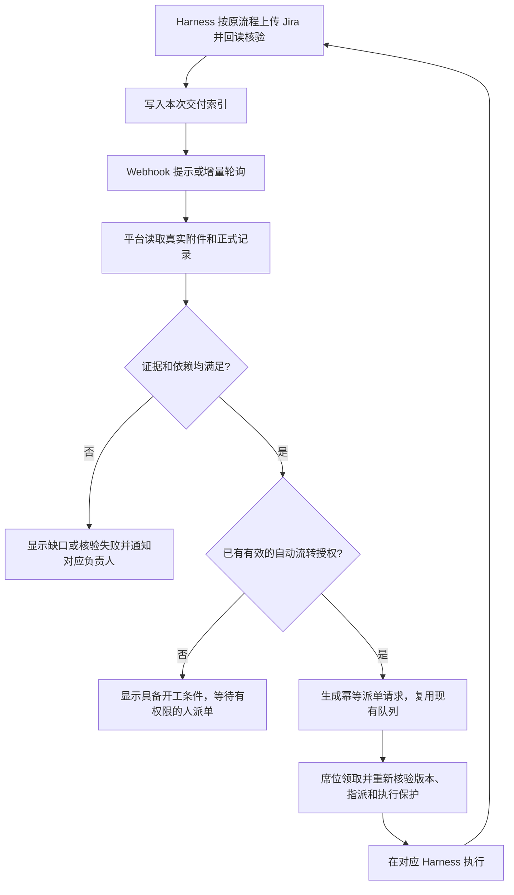
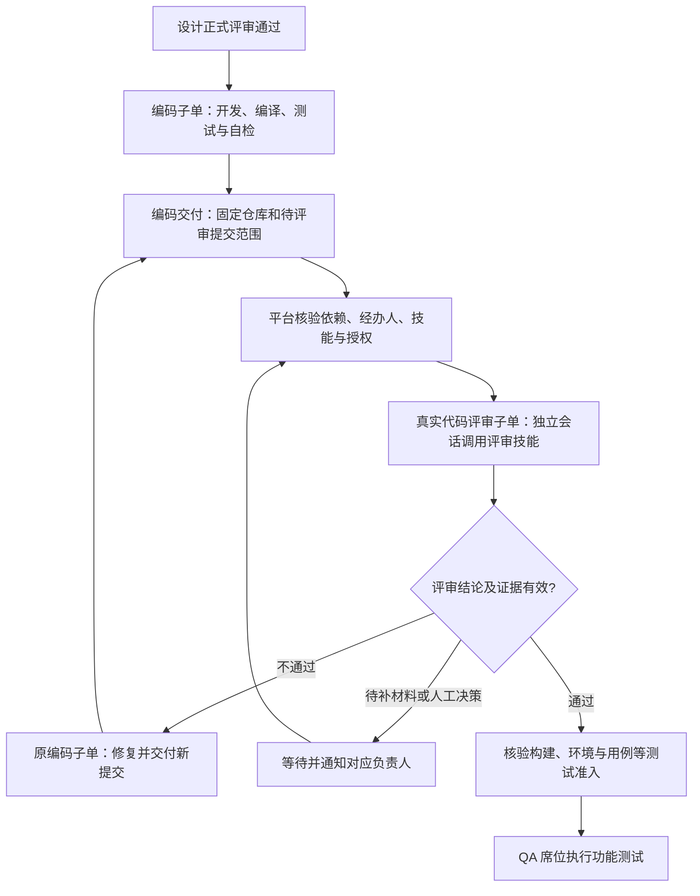

# 基于 Jira 交付证据的依赖核验与自动流转设计

日期：2026-10-25  
状态：设计方案，待实现与验收；本文不代表相关能力已开发或上线。  
关联方案：[主需求交付协同与 Harness 职责整改](2026-10-24-jira-requirement-delivery.md)。

## 1. 目标与设计修正

各环节的交付物已经上传 Jira。后续改造应以 Jira 为交付物和正式评审结论的主要来源，增加“交付索引 → 证据核验 → 依赖计算 → 自动派单”，不要求 Harness 向智研平台重复上传同一套文档。

主需求是交付协调容器，负责人取 Jira 研发负责人字段；子单保留真实 Jira 身份，经办人关联各自席位。编码保留自检；正式代码评审改为独立派发真实评审子单，在目标研发席位开启独立会话调用专门评审技能，平台核验该次评审的范围、版本和结论。设计评审及需要人参与的用例评审沿用正式领域流程。

平台不以 Claude 退出、任务显示完成、附件存在或普通“同意”评论作为充分放行依据。自动推进需要确认：交付物属于本次任务、版本有效、正式门禁已满足、后续执行已有有效授权。

## 2. 已核对的 Harness 基础

以下为本次对仓库规则的核对结果，不等于已逐单验证线上 Jira 的交付完整性。

| 领域 | 现有基础 | 可复用内容 |
| --- | --- | --- |
| 需求分析（补充核对） | base-harness-analysis-suit 已有 P0-P4、证据/需求引用和真实评审指纹；暂无外部自动发布/Tracker | 复用原生产物及指纹，新增独立分析任务与交接发布索引；不当成已上传 Jira |
| 研发设计 | 完成评论、编码必读文件清单、交付 ZIP；编码流程已有设计产物指纹检查 | 附件及必读材料目录、适用版本、设计变更依据 |
| 研发编码 | 完成后上传需求、评审、测试和完成报告等产物 ZIP | 当前编码交付、关联代码评审证据 |
| 关联代码评审 | 按真实评审单记录范围、被审版本、报告路径、评论 ID、附件 ID、实际 Jira 状态及独立 Tracker 上报 | 代码评审与编码范围映射、交付及版本依据 |
| 测试上传 | 附件列表回读、大小核验，重要产物下载比对 SHA256 | 上传后的实际附件身份和内容校验结果 |
| 测试用例 | 按模式交付 Excel、XMind、自动化材料等；不同模式的交付文件集合可能不同 | 当前有效用例版本及评审材料，不硬编码所有任务必须上传同类文件 |
| 功能测试 | 测试报告、执行记录、缺陷清单及截图等交付；实际是否上传遵循原有授权 | 测试结论、覆盖情况、未覆盖项和缺陷依据 |

核对来源：

- 研发：`base-harness-infrastructure-dsp7/.claude/skills/jira-design-doc/SKILL.md`、`jira-feature-dev/SKILL.md`、`jira-feature-dev/references/code-review-ticket.md`、`jira-upload-artifacts/SKILL.md`。
- 测试：`qa-harness-infrastructure/.claude/skills/jira-testcase-writing/SKILL.md`、`jira-testcase-execution/SKILL.md`、`jira-upload-artifacts/SKILL.md` 及其上传脚本。

## 3. 系统职责和事实来源

| 系统 | 主要事实来源 |
| --- | --- |
| Jira | 主子单关系、经办人、交付附件、交付说明、正式评审记录与状态 |
| GitLab / 构建系统 | 提交、合并结果、构建产物及流水线结果 |
| Harness | 领域执行门禁、当前交付记录、评审范围及版本关联 |
| Tracker | 独立上报回执、工时和效果数据 |
| 智研平台 | 保存证据索引及核验快照、计算依赖、解释阻塞、记录授权并派单 |

平台可以引用 Harness 提供的领域结论，但必须说明来源，不宣称自己独立验证了全部业务正确性。Jira 连接读取权限与平台执行授权分别校验；拥有读取 PAT 不等于获得派单权。

## 4. Jira 统一交付索引

### 4.1 生成时机

研发和测试 Harness 保留原有文档生成、上传授权、敏感信息检查和领域完成门禁。分析套件目前只有本地交付，必须先适配外部发布；未发布的分析包不能按已上传 Jira 的研发/QA 索引处理。在附件上传成功并完成实际回读核验后，向对应真实子单的完成评论中增加机器可读的交付索引。

索引不是新的一套交付文档，只引用已有 Jira 附件和正式记录。附件上传失败、待人工上传或仅有本地文件时，不生成表示“已交付”的索引；保留明确的待处理状态。评论写入失败时可幂等补发，不重复上传成功附件。

### 4.2 建议字段

| 字段 | 含义 |
| --- | --- |
| schemaVersion | 索引格式版本，便于后续兼容 |
| jiraKey、stage | 真实执行子单号和交付环节 |
| deliveryId、revision、supersedes | 交付批次、修订和明确替代关系 |
| artifacts | 附件 ID、文件名、字节数、SHA256 及用途；ZIP 可引用包内必读文件清单 |
| relatedIssues | 明确关联的设计、编码、评审、用例或执行单号及关系 |
| sourceVersion | 仓库和提交 SHA、设计指纹或用例版本，按环节适用 |
| domainGate | 领域门禁结果、检查来源和未决项；不能把有条件通过等同于无条件通过 |
| reviewReferences | 正式评审记录引用及其所审版本 |
| producer | 产生交付的 Harness、席位、执行标识及时间，均为可核验的来源声明 |

平台另外保存 Jira 实际评论 ID、附件元数据、获取时间和核验结果。不能仅凭索引自报的 producer 判定可信；需要结合实际写入身份和授权来源。原始 `state.json`、凭据和完整本地计时账本不写入交付索引。

### 4.3 旧工单兼容

对没有统一索引的历史工单，识别已有完成评论、附件和正式记录，提供候选交付物及缺失项。不能仅按最新上传时间或同名文件猜测有效版本。必要时由有权限的人显式确认关联，记录依据和审计；普通确认不能替代原有设计、用例等正式评审。

不批量重跑历史任务，不自动补造评审结论，也不因一次索引补录自动启动旧工单。

## 5. 平台证据采集与核验

### 5.1 同步方式

优先通过 Jira Webhook 发出变更提示，平台重新读取实际数据；定时增量补查修复遗漏。Webhook 不可用时先使用增量轮询。对纳管主需求及子单同步附件、评论、状态、正式评审记录和父子关系，提供人工“重新核验”入口及最近成功同步时间。

同步按组织、Jira 来源和工单隔离；沿用服务器允许的 Jira 来源与凭据管理，不把 PAT 返回浏览器。下载附件时约束来源、大小、超时和解压范围；附件内容为业务数据，不执行其中的命令或脚本。

### 5.2 核验项目

1. 索引所属真实子单、父需求及交付环节是否一致。
2. 附件 ID 是否属于对应工单，文件是否可读取，大小及适用哈希检查是否通过。
3. 交付版本是否有效，是否已撤回、被替代或存在冲突。
4. 设计、用例及代码评审是否指向本次版本和明确范围。
5. 正式评审是否由有权限的人员或机制产生，其结论及状态是否满足项目规则。
6. 是否存在尚未处理的未决项、附带条件或阻塞缺陷。
7. 构建、部署等外部事实是否与待测试版本对应。

自然语言提取可用于生成候选，不独立决定自动放行。状态名称、流转动作及不同项目的评审判定需按实际配置适配，不写死一套 Jira 状态链。

证据状态至少区分：待采集、待核验、有效、不满足、已过期、待人工核对、读取失败。读取失败不等于证据不存在，也不能被视作已通过。

## 6. 依赖模型与准入规则

| 待推进环节 | 需要的证据与条件 |
| --- | --- |
| 系统设计 | 对应范围的分析交接有效且可访问、所需正式需求评审已通过、轻舟真实拆单/排期已确认；已有正式分析按历史兼容规则关联 |
| 编码 | 对应设计交付有效、设计评审通过，并满足原有研发 Harness 开工规则 |
| 代码评审 | 对应编码交付有效，真实评审子单及经办人明确，仓库和基准/目标提交已固定，目标席位具备专门评审技能及有效执行授权 |
| 测试用例编写 | 所需需求和设计材料达到可编写条件；可与编码并行，不默认等待编码全部完成 |
| 用例人工评审 | 待审用例已交付、版本明确、正式评审责任人确定 |
| 功能测试 | 实际覆盖的研发交付及关联代码评审通过、用例准入满足、待测构建和环境就绪 |
| 主需求验收 | 必要交付齐备、正式人审完成、相关阻塞缺陷已处理，形成验收清单 |

多个编码、评审、用例和测试单并存时，由研发负责人按实际范围确认依赖关系；不能将“同一个父单”视作全部互相依赖。关系编辑不自动授予其他席位的执行权。

没有独立用例编写子单时，允许引用已存在且符合流程要求的用例来源，不凭空创建完成记录。不同用例类型、常规或极速模式按原有 QA 准入规则处理，不新增一条统一人审规则覆盖原有模式。

每条规则明确：适用项目及环节、上游真实工单、所需证据、版本约束、规则版本及例外处理。新规则先用于明确选择的纳管需求，不追溯自动启动历史任务。

### 6.1 版本绑定

评审通过的是提交 SHA-A、环境部署的是 SHA-B 时，必须核对待测构建是否包含已评审交付，以及新增变更是否仍满足评审要求。不能只检查“评审单以前完成过”。设计和用例变更同样重新判断既有评审的适用性。

### 6.2 业务准入与上报状态分开

平台分别展示业务准入和 Tracker 上报结果。研发现有流程允许部分上报失败留待补报，QA 则有更严格的完成回执门禁，应逐项沿用各领域规则；不能把“Tracker 暂未上报”一律转化为业务阻塞，也不能绕过 QA 已有强制回执门禁。

## 7. 自动推进与现有执行通道衔接

主需求提供“满足依赖后自动派单”开关及授权范围预览。启用前确认适用子单、目标席位、准入规则和必要的外发授权边界。按现有管理员及席位授权机制授予权限；业务研发负责人身份不自动带来跨席位权限。授权撤回、负责人变更或席位规则变化后，重新核验尚未执行的请求。

自动推进复用当前派单授权、队列、Jira 独占登记、仓库校验、单执行器保护和本机可见终端流程，不另建绕过保护的启动入口。目标席位离线或忙碌时排队，不擅自换电脑。启动前再次核验，防止排队期间工单指派、版本或状态变化。

用组织、Jira 来源、工单、依赖交付版本集合和规则版本确定推进幂等键，在事务中生成唯一派单意图。Webhook 重复、轮询重读和客户端重试不能产生多次执行。新证据版本先使旧的待执行准入结果失效，再计算是否需要后续操作，不默认重新执行已交付任务。

## 8. 页面与人工处理

需求交付总览增加“交付证据、依赖条件、下一步”三列，可展开查看原始 Jira 附件或正式记录、证据版本、核验时间和未决项。

示例：

> 功能测试：等待测试环境。研发交付及关联代码评审已核验，当前用例评审通过；尚未确认环境部署的构建版本。由环境负责人补充部署记录，满足条件且授权有效后自动派单。

“具备开工条件”“已授权待调度”“正在执行”“等待人工”“交付待核验”分别显示，不把证据通过显示为 Agent 已启动。提供重新核验、处理缺口及原始证据跳转；正式人审继续进入对应流程。

| 变化或异常 | 处理 |
| --- | --- |
| 缺附件、版本、正式评审记录 | 保持等待证据，指出缺少什么及谁处理 |
| 人审不通过或有未解决条件 | 等待修订，不自动当作通过 |
| 设计、代码、用例出现实质变更 | 重新核验受影响的评审及下游准入 |
| 下游已在执行而上游变化 | 标注影响并通知负责人，按明确策略决定暂停或继续，不一律杀进程 |
| 同步、权限或网络失败 | 显示读取失败和最近成功时间，保留证据历史，恢复后重试 |
| 测试发现缺陷 | 按正式流程关联真实缺陷及影响范围，阻止不满足条件的验收 |
| 自动流转被关闭或授权撤销 | 停止新增自动派单，按既有执行控制处理已经领取的任务 |

## 9. 改造范围与上线顺序

| 阶段 | 改造内容 | 验收标准 |
| --- | --- | --- |
| 一：证据可见 | 两套 Harness 补充交付索引；平台同步、核验和展示；旧单兼容 | 能指出证据来源、有效版本和缺失项；无索引、读取失败和重复事件不会误触发执行 |
| 二：依赖可解释 | 主需求依赖配置、规则版本、准入计算、版本失效及人工核对 | 负责人能解释每张子单为什么可以或不能开始；与人工判断对照验证 |
| 三：研发自动流转 | 在显式授权的试点主需求启用“设计评审通过 → 编码派单 → 独立代码评审 → 不通过修复/复审” | 满足条件只派一次；离线排队；启动前复核；授权撤销后不再开工 |
| 四：测试自动流转 | 先完成 QA 执行通道适配，再接通研发交付、用例、构建和环境依赖 | 实际在 QA Harness 执行，保留原生人审、计时、回执、中断恢复及单执行器门禁 |
| 五：验收辅助 | 汇总交付、评审、缺陷和上报情况 | 输出可追溯的主需求验收清单，按正式验收流程关闭，不自动以子单状态替代验收 |

工程涉及：研发 Harness、测试 Harness、平台证据采集与存储、依赖服务、既有派单通道及主需求页面。数据库与 API 的具体契约在实施时按仓库规范补齐；本文未把候选接口写成已存在的能力。

不要求迁移现有席位或重置历史任务。研发 Harness 需新增或复用独立代码评审技能，并将编码流程中的正式评审与回执迁出，编码自检继续保留；新流程仅对明确切换的任务启用。交付索引需兼容旧客户端；未具备 QA 运行能力的席位不展示可用的测试自动执行入口。

## 10. 验证重点

- 交付物已在 Jira：平台引用原附件，不要求重复上传。
- 附件存在但属于旧交付、错误子单或不可读取：不得放行。
- 普通评论“同意”与正式评审结论分开；有条件通过逐项检查条件。
- 编码与独立代码评审保留各自真实身份、会话、工时及回执；编码流程不再重复完成正式评审单，同一评审版本的重复事件只产生一次派单。
- 设计、代码、用例和待测构建版本不一致时，明确显示缺口。
- 多编码单、多评审单和多测试单按真实覆盖关系核验，不按同父关系猜测。
- 重复事件、漏事件、网络中断、索引补发、撤销授权和版本替换不会重复开工。
- 旧工单补录和规则变更不会自动重跑历史任务。
- QA 上传授权、用例模式和 Tracker 原生门禁保持原有语义。
- 公司边界、读取权限和派单权限分别校验，不从主需求负责人字段推导管理员权限。

## 11. 轻舟流程补充与方案修正（2026-10-25）

需求条目全流程以轻舟为主入口，增加“轻舟条目 → Jira 主工单 → 实际子工单 → 席位执行”的关联层级，优先读取轻舟已有分析、拆单和排期，不让智研平台独立重建一套业务计划。设计与编码可由同一研发席位执行，无须新增席位职责类型。验收/发布/关闭按轻舟正式流程，具体接口尚待真实样本核实；本文原有证据核验规则继续适用。完整补充见 [轻舟需求条目与智研平台执行协同设计](2026-10-25-qingzhou-demand-orchestration.md)。

## 12. 独立代码评审任务与技能（2026-10-25 修订）

本节替代此前“编码流程一并完成正式代码评审、不另派单”的设计。目标流程尚未实现或上线；现有 Harness 的关联评审基础可复用，但不能据此宣称具备独立评审执行通道。

### 12.1 流程与席位

- 设计与编码仍可共用研发席位，不划分新的席位职责类型。评审单按真实 Jira 经办人关联目标席位，不默认发给编码执行者，也不静默改派。
- 评审可以在原席位顺序执行，或在另一研发席位执行；同机顺序执行仍遵守单执行器保护。独立会话使用显式证据包，不依赖编码会话记忆；独立会话并不等同于项目治理要求的独立人员审签。
- 目标席位离线、忙碌或未具备技能时显示具体原因并排队或等待配置，不降级为编码流程代办评审。项目要求人工签署时，Agent 报告只作为材料，不能冒充指定人员的签署。

### 12.2 Harness 技能与交付契约

研发 Harness 新增或复用可独立调用的代码评审技能，技能名及调用契约在实现时核对现有能力后确定，本文不把候选名称当作已存在命令。平台下发明确的执行角色和技能入口，不只依靠“完成某工单”的通用提示词猜测。

输入至少包括：真实评审子单、关联编码子单、需求/设计及其评审引用、仓库列表、每个仓库的目标分支、基准提交 SHA 和待评审提交 SHA、评审规则版本及必要测试证据。多仓库逐一保存，分支名不能替代不可变提交。

输出至少包括：逐仓库实际评审范围、评审报告、问题位置与级别、待决项、明确结论、Jira 附件/评论引用、席位和独立运行 ID、该评审任务的 Tracker 回执。平台核验输入与输出版本一致后，才将该结论用于测试准入。沿用第 4 节交付索引，补充评审批次、基准/目标提交集合及复审替代关系。

编码技能继续编译、测试和自检，交付待评审版本；正式代码评审、评审单完成及其 Tracker 回执改由独立评审技能负责。评审发现问题后交回编码任务修复，不在评审会话中静默修改代码后自行批准。

### 12.3 修复、复审与幂等

- 不通过时保留原报告与问题清单，关联原编码任务的修复轮次。编码重新执行仍需有效授权和执行保护；不自动新建业务子单，不覆盖历史回执。
- 修复交付新的目标提交后，产生新的评审修订及运行，记录被替代的结论。若原评审单已终结，是否重开须遵循 Jira 正式工作流；未能合法流转时保持等待，不能伪造状态或绕过流程创建重复工单。
- 待评审提交发生变化后，旧通过结论不能直接批准新增修改。保留旧结论历史，使受影响的准入快照失效；对新范围重新评审，并核对原问题是否关闭。下游已运行时沿用第 8 节影响处理规则。
- 派单幂等身份包含组织、Jira 来源、评审子单、明确关联的编码交付、逐仓库基准/目标提交集合、评审规则版本与评审修订。重复同步不重复启动；重试沿用既有运行恢复语义，不能冒充新的评审轮次。
- 编码与评审分别统计有效工作时长、Token、评审发现问题数、返工轮次及回执；复审不复制前次工时，不把评审问题数直接当成正式缺陷率。

### 12.4 改造与验收范围

1. Harness：抽取独立评审技能及输入/输出契约，编码技能切换为自检与待评审交付；保留旧任务兼容。
2. 平台与接入桥：新增明确评审执行角色、能力检查和技能路由，替换旧的代码评审拒派逻辑；复用原授权、独占、队列、终端可见性和恢复机制。
3. 证据与依赖：增加“编码交付 → 独立代码评审 → 测试准入”，支持失败修复、版本失效和复审；保留真实子单与独立回执。
4. 页面：单独展示待评审、排队、评审中、等待修复、等待人工、通过及失效原因，显示所审提交与报告。
5. 上线：先完成原席位顺序评审的授权试点，再验证跨席位评审；既有登记无需重建，但客户端/Harness 未升级或能力未满足时不启用新路由。运行中的旧任务继续按原流程完成，不中途抢走其评审职责。

验收覆盖：同席位独立会话、跨席位按经办人匹配、多仓库范围、错误版本拒绝、重复事件只派一次、忙碌/离线队列、无技能或无授权阻止开工、不通过后的修复与复审、旧结论失效、人工审签要求、独立计时与 Tracker 回执，以及旧任务不重复评审、不自动重跑。

## 工程细化及真实样本补充（2026-10-25）

后续实现统一参考[轻舟交付协同工程细化设计](2026-10-25-delivery-orchestration-detailed-design.md)，包括跨系统差异、范围回退、权限、同步、数据/API、运行、风险、通知、统计、页面和升级验收。真实历史依据见[ATS3-00156 样本报告](2026-10-25-ats3-00156-lifecycle-analysis.md)。补充属于待实现设计；旧实现的代码评审拒派测试不证明独立评审已经支持，也不以已完成历史样本验证自动执行链路。

## 需求分析领域补充（2026-10-25）

实际分析套件、P0-P4、独立任务身份、质量评审与正式需求评审区别、本地完成/外部发布、修订失效及研发交接规则，见[分析 Harness 接入设计](2026-10-25-analysis-harness-integration.md)。需求分析可先于 Jira 主子单，索引不得强制所有领域均有 jiraKey；来源类型明确区分，研发/QA 仍保留真实 Jira 单门禁。新分析流程是待适配能力，不改变本文已有研发/QA上传事实。

预算治理补充：所有新增分析/研发/独立评审/复审/QA执行均继承原生公司/项目/agent预算，派单、领取及恢复重复校验，超限保留真实远程停止与用量回执；预算恢复不等于执行授权或领域准入。完整设计及能力边界见[交付预算治理](2026-10-25-delivery-budget-governance.md)，此处为待实现合同，不宣称现有桥已受控。
