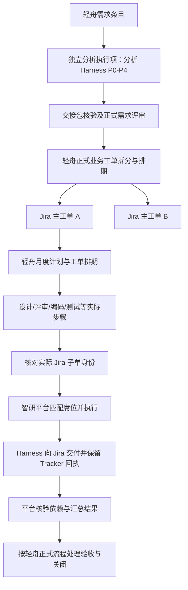

# 轻舟需求条目与智研平台执行协同设计

日期：2026-10-25  
状态：已完成技能核对及 ATS3-00156 历史样本只读核对；方案待实现，尚未发布或完成新流程端到端验收。  
前序：[Jira 证据驱动流转](2026-10-25-jira-evidence-driven-delivery.md)、[主子工单整改](2026-10-24-jira-requirement-delivery.md)。

## 1. 设计结论与适用顺序

轻舟继续作为需求条目正式交付流程的主入口。智研平台既读取已有分析，也可在明确授权后派发独立需求分析任务，使用 base-harness-analysis-suit 生成分析交接包；正式评审、拆单和排期仍在轻舟确认。平台承接 Agent 执行、交付证据核验与协同；不要求负责人重复录入一份相同计划，不在 Jira 另建一套未经轻舟确认的拆单结果。

本设计补充前序方案缺失的轻舟需求条目层级。前序有关 Jira 交付附件、版本绑定、准入核验和派单保护的设计仍适用。涉及计划来源、需求顶层对象和验收归属时，以本文的轻舟边界为准。

分析 Harness 已存在于 `/Users/leo/work/fingard/base-harness-analysis-suit`，支持 P0-P4 原生生命周期；其平台桥及发布/Tracker 适配尚待开发，详见[需求分析接入设计](2026-10-25-analysis-harness-integration.md)。分析执行项可先于 Jira 主子单建立，不把条目本身当作执行任务。

设计与编码优先由同一个研发席位执行不同技能，不增加设计/编码席位职责枚举。实际执行身份按真实子单经办人与现有席位绑定匹配；不同经办人保持实际分工。测试席位使用 QA Harness，须先完成其运行通道适配。

## 2. 本次证据与尚未证明的内容

核对目录：`/Users/leo/work/ai-workspace/.trae/skills/qingzhou-ops`。

已阅读入口技能、创建需求/拆单/排期/拆单验证说明、接口与字段映射，以及 `scripts/methods/query.py`、`ticket_ops.py` 和变更日志。初版仅核对本地资料；2026-10-25 已通过用户登录的 Ego Lite 查询 ATS3-00156 的轻舟详情、审核/变更历史及排期，并与 Jira 真实父子单交叉核对。未变更线上业务数据或启动 Agent。浏览器读取成功不等于生产服务身份认证已打通。

| 事项 | 本地资料可支持的结论 |
| --- | --- |
| 创建需求 | 需求条目包含需求负责人、产品/项目阶段、需求内容、交付年月和交付日等信息 |
| 分析与拆分 | 条目分析由有权限的拆分人保存；条目可拆成多张业务工单，提交并获取 Jira 工单号 |
| 人员与分组 | 需求负责人、拆分人、工单研发负责人及经办人不同；研发分组和测试分组分别记录 |
| 排期 | 按研发分组和月份查询计划，关联条目及目标主工单，安排步骤的负责人、日期和工时 |
| 标准模板 | 技能提供设计、设计评审、编码、代码评审、详细测试用例编写、功能测试六步模板；另有其他可选子任务类型 |
| 拆单验证 | `verify_split` 核对已拆工单列表，不是功能测试或业务交付验收 |
| 最终验收/发布/关闭 | 用户说明流程在轻舟开展，但该技能没有完整的对应操作契约，尚需真实样本与页面/接口核对 |

本次真实核对样本为 ATS3-00156，详见[交付链路核对报告](2026-10-25-ats3-00156-lifecycle-analysis.md)。`ATSES-513244` 仍是另一条待核实的 Jira 线索，不与本样本混用。

## 3. 业务对象层级

条目可以包含多张 Jira 主工单；每张主工单的排期步骤与实际 Jira 子单需要明确关联。不能假设排期记录都已经生成 Jira 子单，也不能按“同名步骤”直接推导实际子单 ID。

### 3.1 外部标识映射

建议新增组织内的外部映射记录，关联现有平台任务，而不替换现有任务 ID：

| 对象 | 需保存的标识 |
| --- | --- |
| 轻舟条目 | 轻舟来源、条目编号 `demandNo`、条目查询接口的内部 ID |
| 分析执行与交接 | 轻舟条目/分析记录引用、独立平台分析任务、修订、本地任务 ID、P0-P4/门禁、评审指纹及交接发布引用；Jira key 可不存在 |
| 月度计划与条目关联 | 研发分组 ID、月份、`manageId`、计划查询上下文中的条目 ID |
| 轻舟业务工单 | 需求分析列表中的工单内部 ID、排期上下文 `issueUrid`、Jira 来源及主工单 key |
| 排期步骤 | 步骤内部 ID（实际返回为准）、类型、负责人、日期、工时及源数据版本 |
| Jira 子单 | 实际 key、父单 key、类型、经办人及其与排期步骤的核验关系 |
| 智研执行 | 已有任务 ID、目标席位、派单授权与运行 ID |

同名 `urid` 来自不同接口时含义可能不同，尤其条目查询 ID、计划中的条目 ID和工单 ID，不能互换。`itemNo`、`issueNo` 等字段需按接口分别适配。缺少唯一映射时显示待核对，不新建任务来掩盖缺口。

## 4. 系统事实来源与权限

| 信息 | 主要来源与处理 |
| --- | --- |
| 需求条目、业务拆单、分组、计划日期与计划工时 | 读取轻舟正式记录 |
| Jira 真实父子关系、工单经办人、当前状态、附件与正式评审证据 | 读取 Jira 并与轻舟记录交叉核验 |
| 本机执行、领域门禁 | 分析/研发/QA Harness 和受管会话；各自原生阶段不能混用 |
| 工时与效果回执 | Tracker；计划工时不能充当实际执行工时 |
| Agent 派单与执行控制 | 智研平台现有明确授权及席位保护 |
| 最终需求验收和关闭 | 轻舟正式业务流程；具体读取/回写契约待核实 |

轻舟与 Jira 的经办人、版本或映射不一致时，不静默覆盖任何一边；展示差异、阻止受影响的自动启动，并按正式流程修正后重新核验。规划 Agent 的建议不能覆盖源系统的已确认计划。

需求负责人、拆分人、主工单研发负责人、子单经办人和评审负责人分别保存，不能统一成一个 owner。业务负责人不自动取得平台管理员或其他席位配置权。轻舟研发/测试分组不直接等同于智研公司或组织；同步必须显式绑定目标平台组织与项目，不能据分组名称自动迁移成员、席位或跨组织授予权限。

## 5. 推荐的日常流程

1. 在轻舟创建条目；需要 Agent 分析时，在智研建立关联的独立分析执行项，按需求分析人员匹配已具备分析 Harness 能力的席位。P0-P4 生成交接包并核验真实评审；本地完成与外部发布分别显示，经轻舟正式需求评审后再拆单/排期。已有有效分析直接关联，不要求重跑；无轻舟/Jira 编号的分析诉求也可先建立独立任务，后续显式关联。
2. 智研平台按授权范围同步条目、主工单和已有排期，复用已经接入的 Jira 任务及历史运行。
3. 平台读取实际 Jira 子单，核对步骤身份、经办人、项目仓库及席位绑定；唯一匹配时自动关联，有歧义时集中提示。
4. 负责人首次确认需要自动流转的需求/工单范围、目标席位、计划策略及权限。后续在授权有效且条件满足时无需逐单重复点击开工。
5. 同一研发席位执行设计；正式设计评审由指定人员完成。
6. 设计评审证据及版本满足准入后，平台派发编码子单；编码 Harness 完成开发、测试与自检，交付明确的待评审提交范围。平台随后独立派发真实代码评审子单，目标研发席位开启独立会话调用专门评审技能；不通过则返回编码修复，新提交再复审。编码与评审分别保留真实身份、运行及回执。
7. 用例准备可按真实计划与准入并行；研发交付、对应版本的独立代码评审、用例、构建和环境满足后，再向 QA 席位派发功能测试。
8. 平台汇总交付与缺口，为轻舟正式验收提供证据链接；在验收接口尚未核实前不自动写入完成或关闭状态。

对轻舟修改、分派变化及取消记录增量同步并重新核验。新增或修改排期不是新的平台执行授权；原授权范围外的变化需要补充授权，不能借“自动同步”扩大权限。

## 6. 排期与业务依赖分别建模

技能中的六步模板、默认工时、评审间隔和节假日规则属于排期算法，不是交付准入规则。

- 设计评审排期到了，不代表评审已通过；过了两天也不能替代正式评审记录。
- 平台显示并尊重轻舟的计划日期。是否把计划开始日期设为最早开工时间，由明确的组织/需求策略控制；第一期建议不自动提前于正式计划启动。
- 计划时间到达但证据不足，保持等待并提示缺口；证据通过但未到允许开工时间，显示等待计划时间。
- 六步只是模板，不强制每张工单具备完整六步；不按模板补造 Jira 子单或完成记录。
- 用例编写与编码能否并行按实际依赖判断，不仅按模板行顺序推导。
- 轻舟保留代码评审计划和责任记录；平台按真实评审子单经办人匹配席位，独立派单并在新会话中调用研发 Harness 评审技能。可同席位顺序执行或跨研发席位执行，无须新增席位类型。若现有正式规则要求特定评审身份或独立人工结论，先确认规则兼容性，不能用 Agent 报告冒充指定人员的评审。

## 7. 规划 Agent 的准确定位

规划 Agent 第一期定位为“计划检查与建议”；它与执行需求分析的 Harness 是不同能力，不能用已有规划建议替代 P0-P4 分析交付：

- 读取已有需求分析、业务拆单及排期，列出缺材料、未分派、身份映射歧义、版本冲突和不可执行的依赖。
- 提出可并行项、依赖修正和排期风险，并附证据来源。
- 在智研平台生成建议草稿，不直接变更轻舟、Jira 或席位配置。
- 确需新增业务工单或修改排期时，在轻舟流程内确认并提交，平台随后同步实际结果。

已有 `qingzhou-ops` 场景要求先展示计划、确认后执行，且禁止临时重写 API 调用脚本。未来开展写入场景时复用受支持场景，并保留确认、权限和实际结果核验；不把交付日、默认负责人或示例产品 ID直接当作所有组织的全局常量。

## 8. 首期页面与实施顺序

### 8.1 页面

在现有主工单交付总览之上增加“轻舟需求条目”关联与汇总视图，展示一个条目对应的多张主工单。进入主工单后展示：轻舟计划、实际 Jira 子单、经办人/席位、交付证据、依赖缺口和下一步。

计划、任务状态、证据准入、派单授权和实际执行分别显示。同步异常应显示最近成功时间和差异，不能表现为计划为空或所有任务已完成。

配置以组织级轻舟连接、产品/项目映射、人员与席位关联为主，不让每个席位重复配置同一套轻舟业务计划。轻舟账号与 Jira PAT 是不同认证通道，读取和回写分别校验权限。

### 8.2 顺序

| 阶段 | 交付目标 |
| --- | --- |
| 0：真实链路核对 | 对一条真实轻舟条目建立需求、主工单、排期、Jira 子单及验收的对应表 |
| 1：只读接入 | 同步已有计划，关联现有任务，展示差异与缺口；不创建/修改轻舟工单或排期 |
| 1A：需求分析执行 | 登记分析 Harness 能力、独立分析任务身份及 P0-P4 桥适配，先单席位试点；无 Jira 不冒充研发子单 |
| 2：证据与准入 | 与 Jira 交付索引方案合并，核验设计/评审/编码/测试的版本及依赖 |
| 3：已授权自动流转 | 优先试点设计评审到编码，再接通独立代码评审及修复/复审；可同席位顺序执行，复用现有队列和执行保护 |
| 4：QA 与验收衔接 | 完成 QA 通道后接通功能测试；核实轻舟验收契约后再设计结果回写 |
| 5：规划辅助 | 根据实际需要提供补拆单和排期建议，确认后通过轻舟正式机制提交 |

## 9. 真实样本核对清单

样本：ATS3-00156“DSP日志支持界面查询”。当前为历史完成条目，接入仅作只读核对，不自动重跑。完整依据见[样本报告](2026-10-25-ats3-00156-lifecycle-analysis.md)。

| 内容 | 当前状态 |
| --- | --- |
| 条目编号、内部 ID、人员角色 | 已核对；分析、拆分、主单研发负责人、经办人及验收角色分别保存 |
| 条目下业务主单及 Jira key | 已核对 3 张主单，均显示产品已验收 |
| 研发/测试分组、负责人及版本 | 已核对；业务主单 testGroup 为空，项目测试组及真实测试经办人存在；计划/期望/修复版本分列 |
| 月度计划、步骤 ID、负责人、时间和工时 | 已查询 2024-10、11 两个 manageId，返回同组 18 步；外部身份与上下文分别保存 |
| 每步骤与实际 Jira 子单的关系 | 已交叉核对；Jira 有 20 子单，18 完成、2 作废；排期缺 319268、316460，但保留作废测试 320801 |
| 设计与编码是否同一经办人、对应席位 | 三组均为乐夏光；实际平台席位绑定未核对，不预填 |
| 设计/用例正式评审记录、结论与版本 | 子单完成状态可见；未获取足够结构化证据证明具体交付版本的正式通过 |
| 交付附件、完成评论及 Tracker | 6 个附件元数据与主单提交链接已查；未下载核验附件内容，Tracker 回执未核实 |
| 完成回退及需求范围变化 | 历史显示全部交付回到部分交付、100% 回到50%；变化原因及成员范围不能仅由百分比推断 |
| 缺陷与验收风险 | 查到 5 张关联缺陷，其中 320560 已挂起；正式风险接受依据未核实 |
| 测试后验收、发布、关闭 | 当前主单验收状态及页面验收角色可见；最终项目经理动作与正式写入契约待核实 |
| Jira 与轻舟如何同步 | 两侧分别读取已完成；触发机制、同步时延及是否需手工回写未核实 |

历史完成时间只能证明记录的状态时刻，不用于推断当年实际执行是否严格按新准入规则先后开展。样本核对不等于新运行通道或全流程自动流转已验收。

## 10. 独立代码评审修订（2026-10-25）

正式代码评审从编码流程拆为真实评审子单的独立任务与独立会话；编码保留自检，不再重复完成正式评审及其回执。该调整属于待实现设计，不改变此前代码或上线状态。评审技能契约、版本绑定、多仓库范围、经办人/席位匹配、失败修复及复审、旧客户端兼容和验收要求见[独立代码评审任务与技能](2026-10-25-jira-evidence-driven-delivery.md#12-独立代码评审任务与技能2026-10-25-修订)。轻舟仍负责正式计划，平台同步后在授权有效且准入满足时执行，不另建业务拆单或覆盖轻舟责任记录。

## 11. 工程细化与待核实契约

完整状态模型、范围变化/作废/替代、差异处理、人员与多席位匹配、权限委派、同步与认证、候选数据/API、独立评审及 QA 运行、构建环境、风险接受、决策通知、统计口径、页面交互和升级回滚，统一见[轻舟交付协同工程细化设计](2026-10-25-delivery-orchestration-detailed-design.md)。

其中同步周期、超时、修复轮次和提醒间隔属于建议的可配置默认值，不是已发现的现网规则。生产轻舟认证、正式验收写入、部署系统读取、独立评审实际技能名及 QA 适配命令仍需在对应阶段核实；文档已规定未接通时的只读、人工核对或阻止自动执行行为，不将未知接口当作可用能力。

## 12. 需求分析 Harness 补充（2026-10-25）

已核对现有 DSP 分析套件及其 check，正式技能入口、生命周期、证据/评审/交接、席位配置和待开发边界见[需求分析 Harness 接入设计](2026-10-25-analysis-harness-integration.md)。该设计优先于此前仅消费已有分析的范围限制；独立分析任务不改变轻舟的正式流程所有权，不把本地质量评审视为轻舟正式批准，不绕过后续系统设计与编码/测试门禁。

预算治理补充：所有新增分析/研发/独立评审/复审/QA执行均继承原生公司/项目/agent预算，派单、领取及恢复重复校验，超限保留真实远程停止与用量回执；预算恢复不等于执行授权或领域准入。完整设计及能力边界见[交付预算治理](2026-10-25-delivery-budget-governance.md)，此处为待实现合同，不宣称现有桥已受控。
