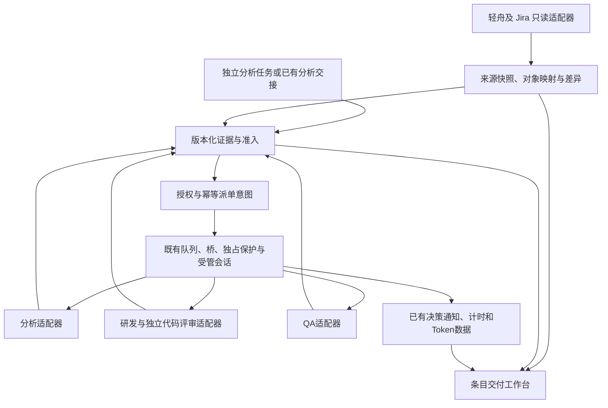

# 未完成交付能力的实现设计与开发拆分

日期：2026-10-25。状态：待开发设计；本次不修改业务代码、不部署。本文将已讨论的方案拆为开发单元，不把设计完成视为代码完成。

业务依据：[轻舟协同](2026-10-25-qingzhou-demand-orchestration.md)、[工程细化](2026-10-25-delivery-orchestration-detailed-design.md)、[需求分析 Harness](2026-10-25-analysis-harness-integration.md)、[独立评审与证据](2026-10-25-jira-evidence-driven-delivery.md)。事实样本：[ATS3-00156](2026-10-25-ats3-00156-lifecycle-analysis.md)。具体门禁沿用上述文档，本文件明确改造边界和交付顺序。

## 1. 当前代码与设计差距

| 已有基础 | 不能据此认为已完成的能力 |
| --- | --- |
| Jira 主子单预览、导入及研发子单 prepare 路由 | 没有轻舟条目层、正式服务认证、跨系统持续对账和差异处理 |
| `jira-requirement-plan.ts` 的类型路由 | 代码评审仍为 harness-linked，不能独立派发；done 仍依赖 statusCategory，未实现项目语义规则 |
| 本机桥的 runtime 注册 | 当前主要是单 harnessRoot，不能表示一台电脑多个 Harness 的能力、profile和版本 |
| 需求分析仓库的 P0-P4、check/status/advance | 没有分析任务领取、网页决策回报、平台交付索引或 Tracker 领域适配 |
| 受管会话、派单授权、队列、独占保护及终端控制 | 未形成新分析/独立评审/QA 领域协议；不能简单更换 cwd 就认为通用适配完成 |
| 既有通知、工时和质量统计 | 新条目/多主单/分析/独立评审范围的归属、版本和完整性口径仍需补齐 |

以当前工作区为基线进行增量开发，不覆盖此前未提交改动，不迁移已有组织或要求重建席位。

## 2. 目标结构及两个最小闭环

第一个可验收闭环：在网页接入 ATS3-00156 → 显示3主单/20子单及18步排期 → 解释差异 → 保存只读关联及审计；整个过程不执行历史工单。

第二个可验收闭环：网页创建独立分析任务 → 选择已登记分析能力的席位 → 本机可见 Claude 执行 → 遇到真实阻塞在网页处理并回传 → P0-P4重验及交接索引 → 显示“本地完成/待正式发布”。没有 Jira 编号可完成此闭环；正式业务批准与对外发布未接通时不假装完成。

## 3. 开发包与代码落点

以下新增文件名、模型和协议是建议实现位置，尚不存在的部分须在开发时建立并通过迁移/类型检查。

| 包 | 主要改造 | 涉及位置/复用点 | 单独完成标准 |
| --- | --- | --- | --- |
| W00 原生预算与计量准入 | 全适用策略、统一入账/去重、许可与远程停止、暂停恢复及通知；严格预留仅对有可靠上限的适配器 | 原生budgets/costs/heartbeat、桥派单/恢复与停止、预算UI；详见预算治理设计 | 新执行路径预算全覆盖；停止有真实回执、计量缺失不冒充零费用、恢复不绕过其他阻塞 |
| W01 领域合同与能力登记 | 分析/研发/评审/QA明确角色、协议版本、同席位多能力，本机路径与共享仓库身份分离 | `packages/shared/src` 新增 delivery/harness 合同；扩展 `server/src/routes/dsp7-seats.ts`、桥 `seats.py` 及席位配置 UI | 旧客户端继续原路；新客户端能分别报告三类能力，路径不会跨机串用 |
| W02 连接与来源适配 | 轻舟服务认证、允许来源、分页/完整性、无损ID、Jira项目状态语义 | 新增 `server/src/services/qingzhou-client.ts`、`delivery-source-reader.ts`；复用密钥服务，抽取现有 Jira 只读查询 | 真实读取成功或明确失败；只读调用无写副作用；认证缺失不被显示为空数据 |
| W03 条目纳管与差异 | 预览/导入、主子单映射、排期重复去重、作废/替代/计划外单及范围版本 | 新增 delivery schema/迁移、service/routes；复用 issues 的真实任务身份 | 样本结构正确；重复导入不重复；差异不静默修正外部系统或扩大授权 |
| W04 需求分析执行 | 独立分析身份、P0-P4 CLI适配、技能加载、原生状态及交接采集 | 桥新增 `analysis_runtime.py`；平台新增 analysis routes/service；调用现有 analysis.py | 不依赖 Jira；不覆盖任务；status错误正确阻止交付；暂停/恢复不丢证据 |
| W05 证据与准入引擎 | 附件/正式记录索引、版本/hash、规则及逐条件结果、过期和范围变化 | 新增 evidence/gates services；研发/QA补交付索引，分析走其本地/发布清单 | unknown不能放行，旧版本不能放行；平台能解释每个阻塞项 |
| W06 交付授权与调度 | 需求范围授权、动作委派、派单意图和outbox，复用既有派单/队列 | delivery orchestration service、`dsp7-jira-dispatch.ts`及桥命令领取入口 | 管理员与已委派主体可合法派发；重复事件只起一次；撤销/领取前变化有效 |
| W07 独立代码评审 | 提取独立技能、编码只保留自检、修复与复审 | 研发 Harness技能；`jira-requirement-plan.ts`、prepare/授权检查、桥技能路由、总览 UI | 真实评审单独立会话/计时；不是修改描述绕过旧拒派规则；版本改变重新评审 |
| W08 QA执行与准入 | QA原生启动/续传/停止/交付接口，构建/环境/用例核验 | 桥新增 `qa_runtime.py`，QA Harness原生契约，构建/环境只读适配器 | 真正QA技能执行；环境不符不能开始；保留原人审、上传授权及Tracker门禁 |
| W09 决策、协同页面与通知 | 统一阻塞事件、责任人、网页回答ACK，复用机器人通知 | 受管会话/通知服务、条目/分析详情、工作台及帮助 | 网页可见过程与待办；回复可靠送达；陈旧决定不作用到新版本 |
| W10 统计、验收辅助及发布 | 汇总口径、完整性、正式验收清单、功能开关和回滚 | 现有managed报告服务/统计UI；delivery报表和验收视图 | 不重复工时/Token、不伪造缺失值，不以平台就绪冒充正式验收 |

所有新表均按公司隔离，经 schema → 生成迁移 → shared → server → UI 同步变更；不将新增领域主数据存进可编辑任务描述或以 activityLog 代替关系表。activityLog 用于审计，受管私有会话沿用独立访问控制。

## 4. W01 统一执行请求与兼容设计

目标请求至少包括：`protocolVersion / companyId / taskId / sourceRef / executionRole / harnessCapabilityId / workflowMode / inputManifestRef / inputDigest / grantVersion / requestId`。平台选择的能力与客户端登记匹配，客户端不接受任意网页输入的 shell 命令或未知技能。

- `sourceRef` 可为轻舟分析任务、Jira真实子单或独立平台分析诉求；研发/QA仍必须验证真实Jira身份。
- `executionRole` 至少区分需求分析、系统设计、编码、代码评审、用例编写、功能测试；正式人审是决策活动，不路由为通用编码任务。
- `harnessCapabilityId` 对应稳定仓库/领域/profile及当前席位本机映射，不将全局项目路径当本机 cwd。
- `workflowMode` 固定该任务的旧编码评审一体模式或新独立评审模式；不对运行中旧任务热切换，不双重持有同一正式评审职责。
- 缺能力/协议不兼容时为待配置/升级，不能自动回落到“完成某工单”的通用提示词。
- 本地API密钥、MCP及知识库沿用登记配置；记录配置来源和摘要，不回传密钥或让网站静默覆盖本地环境。

公司/项目/agent预算按统一服务检查，能力缺计费或停止合同不得宣称预算受控；启用硬预算时按策略阻止新自动执行。控制链复用已有 start/resume/stop 保护。领取权、席位执行锁和运行实例身份分别验证；客户端重启通过既有运行身份对账，不能只根据本地任务目录存在就判断可以恢复或已经停止。

## 5. W02-W03 只读接入的确定行为

生产轻舟认证仍为实施前待核实契约。先验证正式服务身份或受支持的账号会话续期，不采集个人浏览器Cookie作为长期配置；暂不可用时开发不停止，可用脱敏响应做适配/回归及标注来源的人工快照导入，但必须标为 manual_snapshot，不具有在线新鲜度，也不能自动派单。

预览统一返回：来源时间/完整性、需求/主子单/步骤身份、人员候选、真实状态与语义状态、平台已有任务链接、差异项和指纹。管理员确认导入仅保存关联。请求外部数据成功后再入事务；事务提交时复核连接/项目/快照版本并按来源身份加唯一约束，避免长时间持锁等待网络。

每次同步产生新快照，不覆盖历史成员集合。缺单须区分查询不完整与真实移出；取消/作废/替代均按工程细化规则处理。差异解决、派单授权和正式业务评审是三个不同动作，按钮与审计不能合并。

状态映射采用项目配置而非中文名称写死；迁移前旧代码逻辑可保留，但新自动流转只对有完整映射的项目开启。未映射状态是 unknown，不能从 done/statusCategory直接推导正式验收。

## 6. W04 最小分析闭环

1. 创建独立分析执行项，绑定负责人、项目和修订；轻舟条目可空。未派发前不启动本机进程。
2. 能力探测确认实际仓库/入口/解释器/profile；生成不含敏感信息的稳定本地任务ID。
3. 首次 init；已有任务先 status，加载 analysis-resume；新任务加载 dsp-requirements-analysis，平台不循环advance替代Agent分析。
4. 桥回传阶段快照、gate_errors、阻塞问题和运行状态；单独解析 status 输出，不以退出0判成功。
5. P3只关联真实评审；材料变化使旧指纹批准失效。Q-ID/修订/问题版本绑定网页决定，ACK仅说明送达。
6. P4重验后采集原生产物索引与单独handoff哈希，页面区分本地完成和正式发布状态。
7. 对外上传接口尚未完成时允许正式人工发布并登记/回读引用；无共享材料不触发研发准入。

分析任务可以先验证端到端运行，无需等待完整轻舟服务认证。正式拆单和验收仍需对应正式来源记录，不因分析试点成功自动启用外部写入。

## 7. W05-W08 证据与自动协同的执行边界

准入引擎只产生可解释结果，不直接启动进程；调度引擎消费有效准入加明确授权，生成唯一派单意图，再调用既有队列。任何读/写失败都不得通过默认值产生准入通过。

| 后续动作 | 必须核对的版本/事实 | 不满足时 |
| --- | --- | --- |
| 系统设计 | 实际适用的分析/需求基线、所需正式评审、真实设计子单与材料访问 | 等待证据/正式拆单；已有历史正式材料按核验结果复用 |
| 编码 | 对应系统设计与正式设计评审、真实编码子单和仓库 | 不从分析P4直接跳到编码 |
| 独立代码评审 | 编码交付、逐仓库base/head SHA、真实评审单/经办人及技能 | 排队或等待材料，不调用编码技能代评审 |
| 修复/复审 | 明确不通过问题、合法修复轮次、原授权允许、当前提交版本 | 等待补充授权/决定；不得自动无限循环 |
| 功能测试 | 有效代码评审、用例及所需人审、构建摘要、实际部署环境 | 等待缺口；不把JAR附件存在当作环境已就绪 |
| 验收就绪 | 当前范围交付、正式人审、测试结论、缺陷和有效风险接受 | 生成缺口清单，不自动关闭主需求 |

独立评审不能只把 RequirementMode 从 harness-linked 改为 development：必须同时改 shared角色合同、服务端授权/prepare、桥技能路由、研发Harness交付职责、独立回执及UI。新旧路径按workflowMode分支测试，防止重复评审或降低旧防护。

QA同理不得仅修改harnessRoot，先核实QA实际入口与领域完成合同再建立适配器；构建/部署连接缺失时采用带来源的人工核验，显示证据等级，不假装自动验证。

## 8. 前端入口与角色操作

管理中心新增“交付集成”，配置连接、项目/来源、状态语义及委派；日常工作台新增“需求条目”和“需求分析”入口。现有“接入 Jira”保留用于已拆出的真实工单，不要求分析任务先伪造Jira编号。

条目详情展示分析执行项、主子单树、计划/实际差异、准入条件、下个动作及验收清单。任务页统一通过既有受管会话组件查看过程，避免创建第二套聊天正文存储。席位页增加“执行能力”，按负责人权限维护本机多Harness映射。

主操作由状态决定：接入只读条目、创建分析、授权排队、处理缺口、回答当前问题、查看正式评审、恢复已停止任务。没有在线能力或授权时给出准确缺口，不显示点击无效的启动按钮。列表摘要先加载，证据/子单/正文分页按需读取；返回保留项目筛选和位置。

## 9. 通知、统计与验收的增量边界

复用现有站内/钉钉机器人通道，新增领域阻塞事件只提供真实责任人、任务/修订及处理链接；不重建机器人管理。新增决策绑定版本、投递/消费回执、去重和过期处理，用户无需退出Claude才能答复。正式评审继续走其真实业务流程。

工时/Token从已有受管运行和Tracker分别读取；分析套件没有Tracker接口时标未接入。跨月/改派按事件区间和执行当时归属统计，不向条目/主单重复加账。进度及缺陷率分母沿工程细化口径，有缺失则显示完整性，不能当作零。

首期验收辅助只生成材料清单与正式入口，不实现未经核实的轻舟验收写接口。若后续增加回写，作为独立开发包验证权限、源版本、幂等和回读，不混入本轮自动执行开关。

## 10. 开发顺序、开关与验收矩阵

| 迭代 | 开发包与交付 | 放行条件 |
| --- | --- | --- |
| I1只读纳管 | W02/W03及条目页面；W01合同可同时准备 | ATS3-00156结构和差异正确，无写入外部系统、无自动执行；认证不可用时明确区分离线样本与线上接入 |
| I2分析试点 | W00预算必要能力、W01/W04及所需W09最小决策链路、W05分析交接核验 | 网页到本机真实Claude可见运行、实际业务决定可回传、P0-P4有效；无Jira也可运行 |
| I3研发协同 | W05/W06/W07及交付/独立评审页面 | 设计评审→编码→独立评审→修复复审，授权/版本/幂等/独占均有效 |
| I4测试协同 | W08及用例/构建/环境准入 | 真QA执行，保留原人审/上传授权/Tracker，错版本/缺环境不放行 |
| I5管理闭环 | W09完整通知策略、W10报表和验收清单 | 日周月季年口径/权限正确，风险及未知项可见，不虚构正式验收 |

每个迭代产出 schema/迁移、shared合同、server/bridge/Harness实现、UI、定向测试、帮助更新及实施记录。功能开关按公司/项目控制，只对选定试点启用，服务端默认不为新来源自动派单。仅文档或单元测试通过不足以宣称该迭代完成。

验证分层：纯合同/归一化测试 → 路由/数据库事务和权限测试 → 桥协议/进程退出恢复测试 → 浏览器交互 → 本机与服务器真实试点。mock验证不冒充外部服务已打通，未运行/跳过的检查单独记录。

关键回归样本包括：3主单/20子单/18步骤、多月份重复、作废测试与计划外完成测试、挂起缺陷、长整数；无Jira分析、status退出0但gate_errors非空、评审指纹失效；领取前撤权/改派、断网/重启/终端关闭；独立评审重复事件、多仓库版本变化及QA原生门禁。

发布先部署兼容服务端，再升级试点客户端/Harness、核对无活动旧执行器，最后开启新领域路由。回滚关闭新增意图、保留运行回报和停止能力；不删除表、历史评审或回执，不把未确认停止的运行派给新执行器。

## 11. 待核实事项与可继续的工作

| 未核实事项 | 开发前需要的证据 | 当前可继续内容 |
| --- | --- | --- |
| 轻舟生产认证/续期 | 正式受支持服务身份及脱敏请求响应，服务端连通/权限验证 | DTO、无损解析、样本回归、只读页面；不得使用个人Cookie长期运行 |
| 轻舟正式评审/发布/验收接口 | 动作、角色、版本、回读及授权契约 | 只读引用和正式入口；不写未知接口 |
| 独立代码评审实际技能 | 研发Harness核对/抽取后的技能入口、输入输出和回执测试 | 角色合同、版本范围、前后端准入与路由框架 |
| QA原生命令和恢复合同 | QA仓库实际运行路径、领域门禁及受支持动作 | 通用传输/能力协议与测试准入页面 |
| 构建/环境正式来源 | GitLab/部署只读身份及不可变构建、部署记录 | 引用录入/人工核验合同，缺证据保持等待 |
| 分析Tracker上报 | Tracker支持的分析身份、类型和回执格式 | 平台真实运行计时/Token；Tracker状态标未接入 |

这些是实施依赖，不是把方案无限延期的理由；独立模块可以按上述降级边界继续，但必须标明数据来源与能力状态，不能靠猜测补成“已完成”。

## 12. 预算治理缺口补齐

新增W00使开发包调整为W00–W10共11包，I1–I5五个迭代不变。W00必须在I2新领域真实自动执行前验收必要能力，详细源码依据、观测成本模式/严格有界模式、入账去重、停止回执和恢复规则见[原生预算治理设计](2026-10-25-delivery-budget-governance.md)。不得等统计页完成后才加预算检查，也不将未知提供方费用视为零。

## 2026-10-25 P1 实现进展补记

独立分析的网页任务、显式派发、本机可见 Claude、版本化决定回传和原生产物索引已实现，并完成隔离真实 Claude 闭环验证。正式发布为人工核验登记，尚无上游自动发布／回读。已于 2026-10-26 发布生产，服务、迁移、静态资源及客户端包核验通过；浏览器验收仍因 ego lite 空间接口无响应待完成。详见 [生产发布记录](2026-10-26-p1-analysis-production-release.md)。实现范围、回归结果及剩余边界见 [P1 实现与验收](2026-10-25-p1-analysis-execution-implementation.md)。本节更新开发进展，不将本文其他规划能力一并标为已完成。
