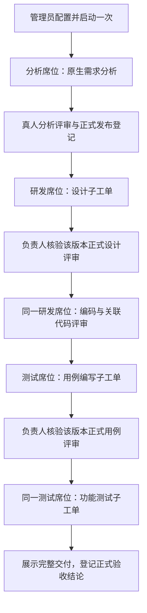

# 条目自动交付最小闭环

日期：2026-10-26。实现范围：同一组织、同一项目、同一主工单下的一条串行交付链。

## 使用方式

进入“需求条目 → 条目详情 → 一键交付条目 → 配置并启动”。选择分析、研发、测试席位，指定已存在且未结束的设计、编码、测试用例编写、功能测试四张 Jira 子工单，提供测试环境和待测构建的正式准入说明链接，点击“启动条目自动交付”。这是本条目后续自动执行的初始授权。

设计和编码共用研发席位；用例和执行共用测试席位。同一台电脑可以登记多个领域 Harness，无需给席位增加固定职责类型。分析使用登记的 analysis 路由，设计／编码使用 development 路由，用例／执行使用 qa 路由，禁止跨领域替代。编码继续包含研发 Harness 内的代码评审。

人工问题在条目流程中答复，平台绑定问题指纹并续传同一 Claude 会话；普通答复不改写原生 Jira 审批，不替代正式审签。分析问题、P3 评审和正式发布沿用独立需求分析页面。设计和用例评审需先在正式流程完成，再在条目中登记结论链接和核验说明；此处明确标注为人工核验，未声称自动回读轻舟审签。

## 运行与证据

服务器保存 `delivery_workflows`、初始授权、固定来源指纹、五个独立阶段任务、派发 ID、真实运行 ID、能力路由、交付指纹、问题及评审记录。服务启动时和执行控制周期中恢复调度，浏览器关闭不影响队列。重复启动使用稳定请求 ID，重复派发使用持久幂等键。

本机接入桥领取运行许可，从本机登记的 Harness 根目录启动可见终端，保留本地 Claude 配置、领域技能、MCP、原生同步和门禁。新客户端声明 `delivery-flow-v1`；旧客户端不能领取新的交付执行通道，须空闲时更新。发布安装包不会强制替换已有运行中的客户端。

分析沿用原生 P0–P4、版本绑定真人评审、七个产物索引和正式发布登记。后续四阶段的完成采集必须同时满足：

1. 原生 state 的工单身份匹配且 completed，没有未通过的当前 Jira 确认及未完成阶段。
2. 本机原生 issue_guard verify 通过，含真实 Jira 类型、子单身份及 task_sync 核验。
3. Tracker 回读中，工单、项目、真实回执匹配；QA 原生上报回执也需匹配。
4. 非空本地产物建立 SHA-256 索引；Jira 至少有一个附件与该工单本地产物指纹相同。
5. 核验前后文件指纹未变化，服务器收到的回执绑定本次任务、运行、阶段、Jira 身份和上游输入指纹。
6. 运行终结并收到进程树停止证明后才能释放当前阶段；设计和用例还须对应交付指纹的真人评审通过。

分析正式交接链接、摘要和上游交付索引传递给下游；下游从正式引用读取原件，不访问其他席位的本地路径。测试环境、待测构建、用例等实际可用性仍由 QA Harness 的原生准入核验负责，平台不能仅凭一个链接推定环境可用。

## 中断和安全边界

- 席位离线、忙碌或暂停接单：等待原席位，不换机、不重复启动。
- 所有人、能力路由或授权人的管理权限变化：拒绝领取／续租，停止推进；保持已有原生数据。
- 费用硬预算无法对新领域实际计价：拒绝自动启动；保留既有预算硬停规则。
- 运行退出但没有有效交付：中断，不能推定阶段完成。显式恢复需核验旧进程树停止，建立新的派发身份，沿用原生任务目录。
- 问题、评审和回执绑定版本，旧指纹提交拒绝；正式交付冻结后不能被另一版本覆盖。
- 来源指纹变化或评审退回：阻塞后续派发。第一期不自动重规划或无限重试。
- 管理员可停止当前执行及后续派发；是否真正停止以本机进程树回执为准。
- 阻塞问题、设计／用例评审沿用席位配置的企业机器人接收人。原生问题还显示本机提醒；未配置机器人不虚构通知送达。DING 仍受现有在线等待核验约束。
- 平台保存验收登记，不自动关闭 Jira 主单，也不修改轻舟正式业务状态。

## 本期未扩展的范围

并行研发分支、自动拆单、缺陷修复回环、退回后的自动重规划、跨组织派发、多主单同时编排、正式审签系统自动回读及自动关闭主需求。本期以已有真实四张子单和三个领域的已登记能力完成串行成功路径。

## 验证与交付

数据库迁移由 `pnpm db:generate` 生成：0298。数据库集成测试覆盖五阶段推进、幂等启动、离线／忙碌等待、旧版本拒绝、机器租约、问题答复、正式评审、进程树停止和验收。客户端测试验证原生状态、工单身份、待确认事项、Jira 附件指纹、产物路径和回执 ACK。ego-browser 空间 107 在隔离 API 场景操作真实 React 组件，验证配置启动、问题续传、版本评审及后续阶段展示；已结束并清理夹具。

这不等于已用未完成的业务工单完成真实分析、开发及 QA 验收。生产部署、数据库迁移和相关席位客户端更新需在发布时执行；本次实现不自动派发线上业务任务。

## 执行过程展示（2026-10-26）

工单详情的「本机会话与 Harness 进度」增加执行流程视图，复用现有受管会话接口及正文权限。可选择本次或历史会话，默认展示执行流程，亦可切换完整对话、工具及终端补充记录；分析执行详情共用同一组件。自动交付创建的研发／测试任务也展示此入口。

- 总览呈现本轮总历时、Agent 执行、人工等待、状态未知、时间观测覆盖和关联缺陷；无质量快照显示「未采集」。
- 阶段条按实际事件顺序生成，按流程版本隔离，不硬编码研发、分析、测试的阶段数量或完成百分比。默认定位最近上报阶段，人工选择后保持选中。
- 阶段详情呈现最近开始／重开、最近事件、完整起止记录的阶段历时、门禁脚本结果、SHA-256 指纹及原始事件。重开覆盖此前通过状态，不将旧版本通过证据沿用为当前阶段通过。
- 只有最新通过事件携带完整门禁版本和脚本结果证据时，才显示「门禁通过」；单纯观察或无证据的通过上报均不推定交付完成。门禁证据的展示不替代正式评审及验收。
- 目前接口未提供阶段内执行／等待拆分、Token 和统一可下载产物索引，因此不制造零值或据对话推断；正式产物仍通过任务或条目交付证据查看。
- 阶段流程视图不拉取会话正文清单，切换对话或终端后才读取。窄屏阶段条局部横向滚动。

验证：新增 5 项组件／阶段聚合回归；ego-browser 使用隔离模拟会话验证阶段选择、门禁证据、对话切换与历史无阶段空态。未执行真实业务工单，未发布生产。
